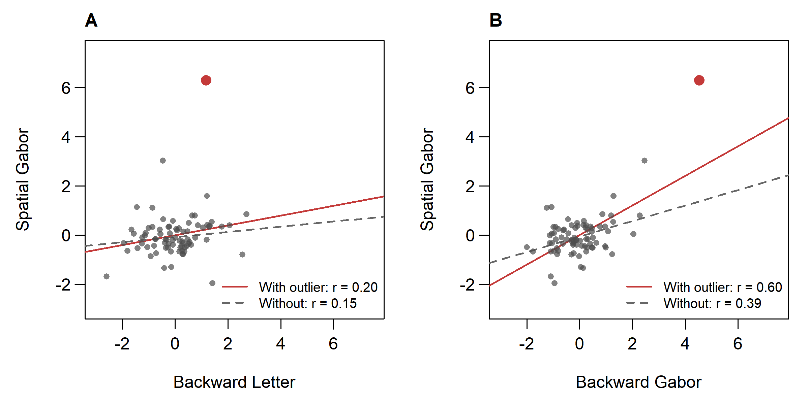
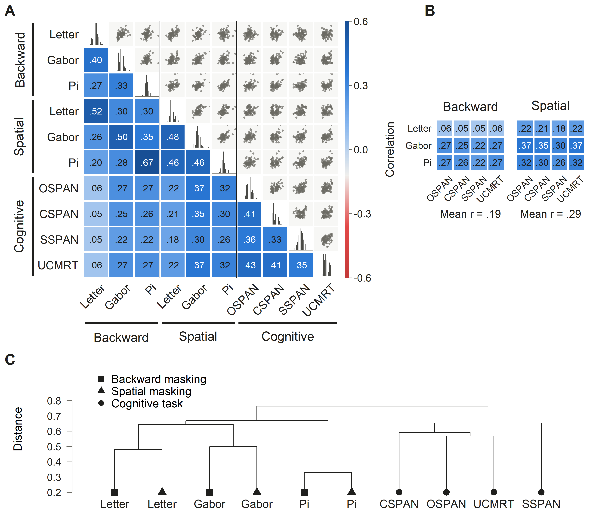
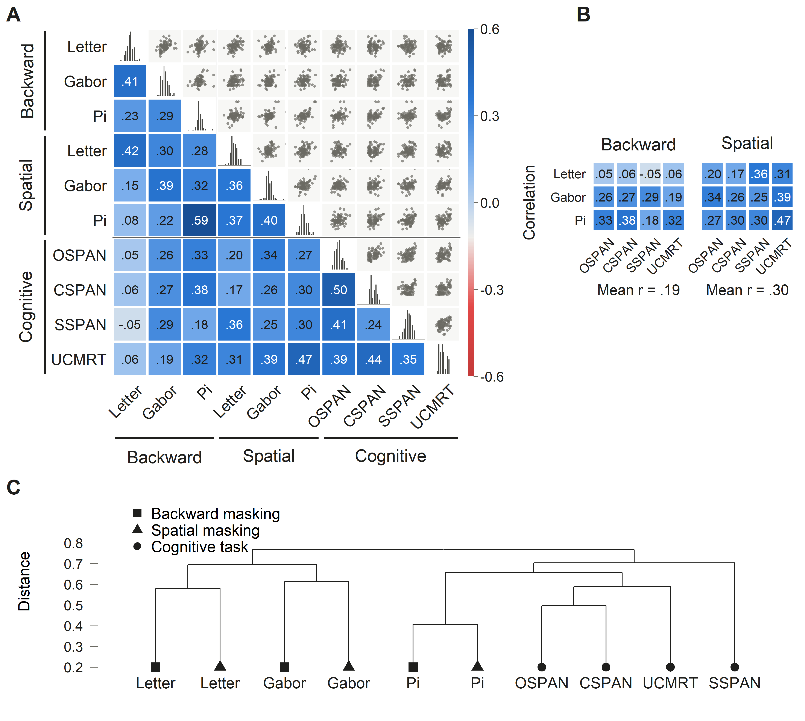

```{r}
knitr::opts_chunk$set(
  echo = FALSE, 
  message=FALSE, 
  warning = FALSE)
```

```{r temporal, echo = FALSE, fig.cap = "Trial sequence of the three backward masking tasks. Rows show the Pi, Letter, and Gabor tasks. Each trial began with a fixation cross (485 ms), followed by the target. After a variable stimulus onset asynchrony (SOA), the target was replaced by a sequence of five masks (48.5 ms each): line segments for the Pi task, frequency-matched letter noise for the Letter task, and white noise for the Gabor task. Individuals then judged which leg of the Pi was longer (left or right), which of nine letters (A-L) was presented, or whether the Gabor was tilted to the left or right. The response screen remained until response. Task difficulty was adjusted by varying the SOA.", out.width = "100%"}
knitr::include_graphics("Figures/temporal.png")
```

```{r spatial, echo = FALSE, fig.cap = "Trial sequence of the three spatial masking tasks. Rows show the Pi, Letter, and Gabor tasks. Each trial began with a fixation cross (485 ms), followed by the target embedded in the same mask as in the corresponding backward masking task (485 ms): line segments for the Pi task, frequency-matched letter noise for the Letter task, and white noise for the Gabor task. Individuals made the same judgments as in the backward masking tasks, and the response screen remained until response. Task difficulty was adjusted by varying the leg-length difference of the Pi, the target weight in the letter-noise blend, and the contrast of the Gabor, respectively.", out.width = "100%"}
knitr::include_graphics("Figures/spatial.png")
```

```{r leverage, echo = FALSE, fig.cap = "Something", out.width = "100%"}

```

```{r sem, echo = FALSE, fig.align = "center", fig.cap = "Something", out.width = "100%"}

```

```{r summary, echo = FALSE, fig.cap = "Something", out.width = "100%"}

```


# Introduction

One of the most striking findings in individual-differences research is that performance on simple perceptual tasks predicts performance on higher-order cognitive tasks such as working memory and fluid intelligence tasks [@Jastrzebski.etal.2021; @Tsukahara.etal.2020; @Robison.etal.2026a]. The finding is old, perhaps first explored by @Galton.1883 and @Spearman.1904.  Perhaps the best documented link between perceptual ability and higher-order cognition comes from the inspection time (IT) task. The classic version of the task is shown in  Figure \@ref(fig:temporal)A.  Here, individuals briefly view a simple figure and make a perceptual judgment.  The brief display of the simple figure is followed by a pattern mask such that the visual information is available for a limited time.  Consequently, accuracy is not at ceiling [@Vickers.etal.1972a].  Individuals with higher accuracy on these inspection-time tasks tend to score higher on tests of intelligence [@Nettelbeck.Lally.1976a; @Deary.Stough.1996], with a meta-analytic correlation of about $.3$ across 92 studies [@Grudnik.Kranzler.2001; @Kranzler.Jensen.1989a].  

Why should accurate judgement about brief displays be related to high performance in working memory and IQ tasks? The standard answer is based on *processing speed*. People who do well on the IT task are good at extracting visual information quickly. They have fast visual processing speed. The claim then is that processing speed is not domain specific but is a general phenomenon that affects many cognitive processes [@Vernon.1983; @Salthouse.1996; @Jensen.2006].  Individuals with fast processing speed do well in working memory and IQ tasks because it is general. The processing speed account of the correlation makes sense. Yet, we worry here about the claim that inspection time indexes processing speed per se. Certainly, it is plausible that individual differences in inspection time tasks reflect processing speed, but, on the other hand, they may reflect factors that do not have a temporal basis. We refer to these as spatial factors, in contrast to the temporal factor of processing speed: the ability to resolve the target clearly and to filter it from the mask. In the modern literature, perceptual abilities that are not time limited also correlate with intelligence and working memory [@Mosing.etal.2014; @Mikellidou.etal.2023; @Deary.etal.2004;@Tsukahara.etal.2020]. A good example of this correlation comes from @Tsukahara.etal.2020 who measured how well individuals could discriminate between the loudness of tones, the pitch of tones, the length of lines, and the area of circles. These discrimination abilities correlated between 0.16 and 0.53 with progressive matrix reasoning tasks. These findings do not rule out a processing speed explanation *per se* as these tasks may require speediness in maintaining representations across different fixations and attentional moments for comparison.

In practice, it seems difficult to determine if the correlation between perception and higher-order cognition is mediated by temporal or spatial factors.  The reasons for these difficulties may be seen in the recent study by 
@Jastrzebski.etal.2021 who administered a series of IT tasks, a series of sensory discrimination tasks, and a battery of working memory and intelligence tasks to the same participants. There are both statistical and methodological reasons for the difficulty.  The statistical reason is that the correlations form an almost perfect triangle of values: the latent inspection-time factor correlated about $.63$ with the latent sensory-discrimination factor, and each correlated substantially with working memory (*r* = $.68$ between inspection-time and working memory, and *r* = $.66$ between sensory-discrimination and working memory). Yet such a triangle tells us little about why perception relates to cognition. The methodological problem is that the stimuli in inspection time and sensory discrimination are not matched or yoked.  In @Jastrzebski.etal.2021, they used partly different judgments (e.g., length vs. brightness) and partly different stimuli (e.g., lines vs. rectangles) for two kinds of tasks, so their relation to cognition may reflect specific judgments or stimuli rather than temporal or spatial factors. 

Our goal is to put spatial and temporal factors in contrast and ask which factor better mediates the correlation with higher-order cognition.  For the purposes herein, we distinguish between *fast eyes* and *sharp eyes*.  Individuals with fast eyes process visual information quickly; people with sharp eyes process spatial information well in the presence of visual noise.  If the fast-eyes account is correct, the relation between IT and cognitive performance arises because the backward mask limits the time available to process the target. Remove this time limit, and the relation should disappear.  On the other hand, if the sharp-eyes account is correct, then the relation reflects the ability to see under impoverished visual conditions. Improve the visual conditions, and the relations should disappear.

These diverging predictions may be tested in a highly controlled environment where only the type of masking differs. In the *backward-masking* versions of the tasks, the stimuli were relatively clear and the key manipulation was the time between stimulus and a following patterned backward mask.  In the *spatial-masking* versions, the stimulus was presented in stimulus-tuned noise, and the stimulus was displayed for a sufficient time.  In the backward masking version, the duration of information is manipulated and individual differences rely more on processing speed (fast eyes) than acuity (sharp eyes).  In the spatial masking version, the amount of noise is manipulated and individual differences rely more on acuity than processing speed.  Key in this setup is that all other aspects of the stimulus are fairly constant across backward-masking and spatial-masking versions. Thus, the experiment has the potential to discriminate between the fast-eyes and sharp-eyes hypotheses.  

We constructed six different visual perception tasks by crossing three stimulus types with the two mask types.  The two mask types are whether the stimulus is degraded by backward masking or by spatial masking.  The three stimulus types are whether the target is a "pi" stimulus which is standard in inspection time tasks, a letter stimulus, or a gabor grating.  The pi stimulus consists of two vertical segments connected by an upper horizontal segment, and the individual judges whether the left or right leg is longer.  Letter stimuli are just these, and the individual judges which letter is presented.  Gabor stimuli have an orientation that is either -45 degrees from the vertical (left tilting) or +45 degrees from the vertical (right tilting).  Individuals judge whether the gabor orientation is left or right tilting.

The expected data patterns are as follows: if the fast-eyes hypothesis holds, then the three backward-masking tasks should cluster well and the combined latent variable should correlate well with higher-order tasks.  Conversely, if the sharp-eyes hypothesis holds, then the three spatial-masking tasks should cluster well and the combined latent variable should correlate well with higher-order tasks.  Yet, there are data patterns that do not accord with either hypothesis.  Perhaps, there is no special concept of fast or sharp eyes.  An alternative is that some people have better vision than others, and that those with better vision tend to do better on the higher-order cognitive functions.  We call this the *good-eyes* hypothesis.

Given the large literature on the correlation between inspection time and IQ, we ran this experiment to confirm that processing speed was crucial.  We fully expected the backward-masking tasks to cluster and the shared variance among them to drive the correlation between perception and higher-order cognition.  We were quite wrong in these expectations. To foreshadow, we find that the distinction between spatial and backward masking accounts for very little of the variance across individuals.  A factor that accounts for more variance is stimulus type.  It seems that people vary more across gabors, letters, and pi stimuli than they do across spatial and backward masks.  Moreover, it seems that it is what is shared across the stimulus types that drives the correlation with higher-order cognition.  And this fact provides the best evidence that neither spatial nor backward masking is privileged in relating to higher-order cognitive functions.  It seems the good-eyes hypothesis, our add on hypothesis for completeness, best describes the data.

# Experimental Method

The experimental battery consisted of 10 tasks that was run on 83 individuals.  Six of the ten tasks are discussed above and serve as the perceptual part of the battery.  These six are formed by crossing the type of stimulus (pi, letter, gabor) with type of masking (spatial, backward). Of the remaining four tasks, three are span tasks to assess working memory and a fourth is a matrix reasoning task to assess fluid intelligence.

## Participants

Eighty-three undergraduate students at the University of California, Irvine, participated in exchange for $50 in total compensation. Four individuals withdrew before completing all sessions, leaving a final sample of 79. All individuals reported normal or corrected-to-normal vision and provided informed consent. The study was approved by the Institutional Review Board of the University of California, Irvine (Study ID: STUDY00000064).

## Apparatus

Participants were tested individually in a dimly lit cubicle, seated approximately 100 cm from a 24-inch BenQ LED gaming monitor (1920 × 1080 pixels, 165 Hz refresh rate, 6.06 ms per frame). Stimuli were generated with PsychoPy3 [@Peirce.etal.2019] in Python 3.8, running on a PC with Lubuntu Linux 22.04. 

## Tasks

**Task 1: Pi Stimuli with Backward Masking.** Participants completed a two-alternative forced-choice length discrimination task on a $\Pi$-shaped (Pi) target, as shown in Figure \@ref(fig:temporal)A. Each trial began with the presentation of a fixation cross, which was displayed for 485 ms. It was followed by a centrally presented $\Pi$ stimulus in which one of the two vertical "legs" was longer than the other. After a variable stimulus onset asynchrony (SOA), the target was replaced by a dynamic sequence of five masks, each presented for 48.5 ms. Each mask was composed of random oblique line segments forming a $\Pi$-like clutter. Short line elements (randomized in length and orientation) were placed in two vertical columns aligned with the legs of the $\Pi$ and around the crossbar region. Participants judged whether the left or right leg was longer by pressing designated keys on the keyboard. The SOA was manipulated adaptively on a trial-by-trial basis for each participant.

**Task 2: Letter Stimuli with Backward Masking.** Participants completed a 9-choice letter identification task as shown in Figure \@ref(fig:temporal)B. The presented letters were "A", "S", "D", "F", "G", "H", "J", "K", and "L", that is, those that are on the second row of a standard American English QWERTY keyboard. Each trial began with the presentation of a fixation cross, which was displayed for 485 ms. It was followed by a centrally presented target letter. After a variable SOA, the target was replaced by a dynamic sequence of five masks, each presented for 48.5 ms. The masks were FFT-filtered noise with spatial frequencies matching the collection of letters [@Parish.Sperling.1991]. Participants identified the letter by pressing the corresponding key on the keyboard. The SOA was manipulated adaptively on a trial-by-trial basis for each participant.

**Task 3: Gabor Stimuli with Backward Masking.** Participants completed a two-alternative forced-choice orientation discrimination task as shown in Figure \@ref(fig:temporal)C. Each trial began with the presentation of a fixation cross, which was displayed for 485 ms. It was followed by a centrally presented Gabor patch with a random phase and an orientation of $+45^\circ$ or $-45^\circ$ relative to vertical. The patch subtended approximately $8.1^\circ \times 8.1^\circ$ of visual angle and had a spatial frequency of approximately 1.2 cycles per degree, with a Gaussian envelope of standard deviation of approximately $1.0^\circ$. After a variable SOA, the target was replaced by a dynamic sequence of five white noise masks, each presented for 48.5 ms. Participants judged whether the grating was tilted leftward ($-45^\circ$) or rightward ($+45^\circ$) by pressing designated keys on the keyboard. The SOA was manipulated adaptively on a trial-by-trial basis for each participant.

**Task 4: Pi Stimuli with Spatial Masking.** This task matched the temporal $\Pi$-leg discrimination task (Task 1), as shown in Figure \@ref(fig:spatial)A, except that the mask was presented together with the target rather than after it. Each trial began with the presentation of a fixation cross, which was displayed for 485 ms. It was followed by the $\Pi$ target superimposed on a $\Pi$-like clutter mask constructed in the same way as in Task 1, and this target-mask combination was presented for 485 ms. Participants judged whether the left or right leg was longer by pressing designated keys on the keyboard. Instead of the SOA, the leg-length difference was manipulated adaptively on a trial-by-trial basis for each participant.

**Task 5: Letter Stimuli with Spatial Masking.** This task matched the temporal letter identification task (Task 2), as shown in Figure \@ref(fig:spatial)B, with the same nine letters and response keys, except that the target letter was embedded in noise rather than followed by a mask. Each trial began with the presentation of a fixation cross, which was displayed for 485 ms. It was followed by a target letter presented in FFT-filtered noise with spatial frequencies matching the collection of letters, and this stimulus-noise combination was presented for 485 ms. Instead of the SOA, the contrast of letter-to-noise was manipulated adaptively on a trial-by-trial basis for each participant.

**Task 6: Gabor Stimuli with Spatial Masking.** This task matched the temporal Gabor orientation discrimination task (Task 3), as shown in Figure \@ref(fig:spatial)C, except that the Gabor patch was embedded in noise rather than followed by a mask. Each trial began with the presentation of a fixation cross, which was displayed for 485 ms. It was followed by a Gabor patch with the same size, spatial frequency, and envelope as in Task 3, with a random phase and an orientation of $+45^\circ$ or $-45^\circ$ relative to vertical, presented in white noise. This stimulus-noise combination was presented for 485 ms. Participants judged whether the grating was tilted leftward ($-45^\circ$) or rightward ($+45^\circ$) by pressing designated keys on the keyboard. Instead of the SOA, the Gabor contrast was manipulated adaptively on a trial-by-trial basis for each participant.

**Task 7: OSPAN.** Participants completed an automated OSPAN task [@Unsworth.etal.2005] combining simple math operations with working memory recall for letter sequence. Each set contained 3–7 letters, with each set size presented three times, yielding 15 memory sets in total. Before the main task, individuals completed three practice sets of size three to familiarize themselves with the procedure. In the main task, set sizes 3–7 were each presented three times in randomized order (15 sets total). Within each set, trials alternated between (i) a math operation screen (e.g., “6 + 2 = ?”), after which the individual clicked to continue, and (ii) a proposed answer screen showing a single digit; individuals judged whether the digit correctly solved the operation by clicking true/false. A single uppercase letter was then shown for 800 ms, and the sequence continued until the set ended. At recall, individuals clicked the letters in serial order from a matrix. For each set, individuals earned points equal to the set size only if (a) all math operations were solved within the individual's mean solving time in the practice trials plus 2.5 SD, (b) no math errors occurred for that set, and (c) all letters were recalled in the correct order. Sets failing any criterion scored 0. The final OSPAN score was the sum of points across all sets.

**Task 8: CSPAN.** Participants completed a CSPAN task [@Conway.etal.2005] combining serial counting with working memory recall for number sequence. Each display contained a set of target items (green circles) intermixed with distractors (yellow circles). individuals counted the number of targets in each display, after which the individual clicked to continue to the next display. At recall, individuals were prompted to recall the sequence of counts (e.g., “3–5–2”) in the exact order they were encountered. Responses were made by clicking the digits from a matrix. The procedure began with three practice sets of size 2. The main task then presented set sizes 3–7, each three times in randomized order (15 sets total). A set contributed points equal to its size only if the final recall sequence was accurate in both values and order. The final CSPAN score was the sum of points across all sets.

**Task 9: SSPAN.** Participants completed a SSPAN task adapted from the Corsi block-tapping paradigm to assess both storage and processing aspects of spatial working memory [@Pahor.etal.2022a]. On each trial, cartoon gophers appeared sequentially in one of 12 possible screen locations, each presented for 1,500 ms with a 500 ms inter-stimulus interval. individuals were required to reproduce the sequence by tapping the corresponding locations in the exact order. Between each gopher presentation individuals performed a secondary sorting task, dragging an item to the left or right, thereby imposing concurrent processing demands and limiting reliance on mnemonic strategies. Sequence length ranged adaptively from 2 to 10 items, increasing or decreasing in difficulty depending on accuracy. The final SSPAN score was the total successfully recalled items across all sets.

**Task 10: UCMRT.** Participants completed the UCMRT [@Pahor.etal.2019], a measure of fluid intelligence modeled  after Raven’s Progressive Matrices. Each trial presented a 3×3 matrix of abstract visual patterns with the bottom-right cell missing, and individuals selected the option that best completed the matrix from eight alternatives displayed below. UCMRT was chosen because it was especially developed for young adults with above-average performance on matrix reasoning tasks, providing a more sensitive and efficient assessment of individual differences in fluid intelligence in this population. The task consisted of 23 problems of varying difficulty, including 2 two-relation items, 3 three-relation items with a single transformation, 6 three-relation items with two transformations, 6 three-relation items with three transformations, and 6 logic items. Performance was scored as accuracy, defined by the number of correctly solved matrices.

## Procedure

The experiment consisted of three sessions of approximately one hour each, conducted on separate days within one week. Each session consisted of three phases, denoted here Phase I, Phase II, and Phase III.  Phase I consisted of the six perceptual tasks (Task 1-6).  Each task was shown in a single block of 50 trials.  All six tasks were performed for 50 trials each, and the ordering of the tasks was random across days and participants.  Phase III was the same; and across Phase I and Phase III, 100 trials per perceptual task was performed.  These phases were repeated on all three sessions, yielding 300 trials per participant per perceptual task.  This number is quite large compared to other individual difference studies using perceptual tasks.  In these phases and blocks, the difficulty was manipulated in an adaptive fashion.  Two staircases were run interleaved; one was a 2D-1U staircase with an asymptotic limit of .707; the other was a 3D-1U staircase with an asymptotic limit of .794 [@Levitt.1971].  The first masking block served as practice and was excluded from analysis, leaving 250 trials per task (125 per staircase) and 1,500 masking trials per individual for analysis.

Phase II of each session was reserved for the working memory and matrix reasoning tasks.  The OSPAN task was performed in Phase II on Session 1; the CSPAN task was performed likewise on Session 2; the SSPAN and UCMRT were performed on Session 3.

# Analysis Method

We analyzed the data in two ways. The first is a conventional analysis of summary scores. For each individual and task, we computed a single score, screened these scores for outliers, and examined the correlations among tasks. This analysis is simple and transparent, and it lets readers see the data directly. The second is a hierarchical psychometric model fit to the trial-level data. It estimates the relations among tasks while accounting for trial-to-trial noise, so that the estimated correlations are not attenuated and their uncertainty reflects both the sampling of trials and the sampling of individuals. The model also decomposes individual differences into general, masking-specific, and stimulus-specific sources, each of which is related to cognitive performance. The summary-score analysis serves as a descriptive first look, and the hierarchical model provides a more complete accounting of the data.

## Summary Scores, Correlations, and High-Leverage Points

The first step in the analysis is constructing a single score that summarizes performance on each task for each individual. For the three backward masking tasks, the main independent variable is the stimulus onset asynchrony between the target and the mask, which was manipulated adaptively in staircase fashion. For the three spatial masking tasks, the main independent variables are the leg-length difference of the Pi stimulus, the target weight in the letter–noise blend, and the contrast of the Gabor patch, each of which was likewise manipulated adaptively. To construct these summary scores, the mean duration across the 250 analyzed trials was computed. For the four cognitive tasks, Tasks 7-10, the scoring method is standard to the task and described above.

The main target of the summary-score analysis is the correlations between tasks across individuals. The main concern in data quality is that some scores exert unreasonably high leverage on these correlations. Figure \@ref(fig:leverage) shows two scatterplots of individual scores, each plotting one task against another. Both include the same outlying individual. In Figure \@ref(fig:leverage)A, this individual does not change the correlation appreciably; in Figure \@ref(fig:leverage)B, the individual does. We decided the best approach was to discard any score on a task that was more than 4 standard deviations from the task mean, regardless of its effect on the correlations. In total, data from 2 task-by-individual combinations (out of a total of 790 combinations) were discarded. Readers can confirm for themselves that the 4 SD criterion is appropriate; they can also explore the effects of other criteria, which, while affecting the values of specific correlations, do not affect the main conclusions herein.

To interpret the pattern of these surface correlations vis-a-vis the hypotheses, We used hierarchical clustering with average linkage [@Sokal.Michener.1958], as implemented in the hclust function in R, with $1 - r$ as the distance between two tasks. The results are shown in Figure \@ref(fig:summary)C.  In this representation, tasks that are more similar are presented together lower in the hierarchy.  In all cases, the lower level of the most similar perceptual tasks are arrange by stimulus type---gabor grating, letters, and pi stimuli---and not by mask type.  For example, backwards masking in the Gabor stimuli are quite disimilar than backwards masking in the pi stimuli.  Perhaps the only unexpected finding then is that the pi stimuli is disimilar to the other perceptual tasks even though the only difference is the type of stimulus.  As it turns out, when a more complete accounting of the data through hierarhical modeling is performed next, this unexpected finding does not hold.

## Hierarchical psychometric modeling

The summary-score analysis has three limitations. First, the correlations are attenuated, because each score contains trial-to-trial noise in addition to an individual’s true ability [@Spearman.1904; @Rouder.Haaf.2019]. Second, their uncertainty is miscalculated, because it reflects only the sampling of individuals and not the sampling of trials. Third, the correlations alone cannot distinguish among the fast-eyes, sharp-eyes, and good-eyes hypotheses, because these hypotheses concern which source of shared variance carries the relation to cognitive performance. To address all three, we estimated individual thresholds and their relations simultaneously from trial-level data with a hierarchical psychometric model [@Rouder.Mehrvarz.2026]. Because the model accounts for trial-to-trial noise, the estimated correlations are not attenuated and their uncertainty reflects both sources of variability; and because the latent level decomposes individual differences into general, masking, and stimulus factors, the model directly tests which source relates to cognitive performance.

The hierarchical model has three levels. The top level is termed here the *data level,* and it describes how trial data in the perceptual tasks reflect individuals' true perceptual abilities.   The next level, termed the *measurement level* describes how these individual true scores reflect a factor structure where the factors are type of stimulus, type of mask, general visual ability, and higher-order cognitive ability.  The final level, termed the *structural level* describes the association between factors, and in particular, it describes how the cognitive abilities are related to the perceptual abilities. We describe each level in turn.

**Data level.** To specify levels, we need introduce some notation.  The data level is for the perception tasks and it describes how trial-level performance reflects true perceptual abilities.  Let $i = 1,\dots,I$ denote an individual, let $j \in \{1,2,3,4,5,6\}$ denote the perception task, and let $k = 1,\dots,K_{ij}$ denote trial for the $i$th individual on the $j$th task. Let $y_{ijk}$ denote the corresponding accuracy, $y_{ijk}=0,1$ for error or correct responses, respectively. A lognormal psychophysical data model [@Rouder.Mehrvarz.2026] is
$$
y_{ijk} \sim \text{Bernoulli}\!\left(\Phi\!\left(\beta_j\,(\theta_{ij}-s_{ijk})\right)\right),
$$
where $\Phi(\cdot)$ denotes the standard normal cumulative distribution function. The variable $s_{ijk}$ denotes the **strength** of the strimulus defined as follows:  On each trial, there is a natural stimulus intensity variable.  For example in backwards masking tasks, this intensity is stimulus duration measured in milliseconds.  The strength is the log of this duration.  Taking the log has two degrees of freedom, the base and a multiplier which serves as a referent.  To set these degrees of freedom in a consistent way, we simply took the z-score of log intensity where setting mean and variance of the log scores is equivalent to picking a base and referent.  Hence, strength here is standardized logarithm of a natural intensity variable.  Please see @Rouder.Mehrvarz.2026 for additional discussion.

There are two parameters in the above pshophysical model: $\theta_{ij}$ and $\beta_j$.  The parameter $\theta_{ij}$ denotes the latent ability of individual $i$ on task $j$, expressed on the same scale as $s_{ijk}$, and $\beta_j$ denotes the rate of psychometric function on strengths for task $j$.

**Measurement level.** The measurement level describes how true abilities reflect specific factors.  Each individual's perceptual abilities are characterized by the vector $\boldsymbol{\theta_i}=(\theta_{i1},\ldots,\theta_{i6})'$.  Individual's also performed in the cognitive tasks but the scoring rules are standard and do not reflect a trial structure.  Let $\boldsymbol{c_i}=(c_{i1},\ldots,c_{i4})$ be the vector of each individuals' cognitive abilities.  A complete vector of abilities on the ten tasks are:
$$
\boldsymbol{\vartheta}_i = \left(\boldsymbol{\theta_i}',\boldsymbol{c_i}'\right)'.
$$

This vector, $\boldsymbol{\vartheta}_i$ reflects the interaction of perceptual and cognitive factors as follows:

$$
\boldsymbol{\vartheta}_i = \boldsymbol{\mu} + \boldsymbol{\Lambda}\,\boldsymbol{\eta}_i + \boldsymbol{\epsilon}_i, \qquad
\boldsymbol{\epsilon}_i \sim \mathcal{N}_{10}\!\left(\mathbf{0}, \boldsymbol{\Delta}\right), \qquad
\boldsymbol{\Delta} = \operatorname{diag}\!\left(\delta_1^2, \ldots, \delta_{10}^2\right),
$$

where $\boldsymbol{\mu}$ captures the mean of each task, $\boldsymbol{\Lambda}$ is a $10 \times 7$ matrix of factor loading, 

$$
\boldsymbol{\Lambda} =
\begin{pmatrix}
\lambda_1^{(V)} & \lambda_1^{(M)} & 0 & \lambda_1^{(S)} & 0 & 0 & 0\\
\lambda_2^{(V)} & \lambda_2^{(M)} & 0 & 0 & \lambda_2^{(S)} & 0 & 0\\
\lambda_3^{(V)} & \lambda_3^{(M)} & 0 & 0 & 0 & \lambda_3^{(S)} & 0\\
\lambda_4^{(V)} & 0 & \lambda_4^{(M)} & \lambda_4^{(S)} & 0 & 0 & 0\\
\lambda_5^{(V)} & 0 & \lambda_5^{(M)} & 0 & \lambda_5^{(S)} & 0 & 0\\
\lambda_6^{(V)} & 0 & \lambda_6^{(M)} & 0 & 0 & \lambda_6^{(S)} & 0\\
0 & 0 & 0 & 0 & 0 & 0 & \lambda_7^{(C)}\\
0 & 0 & 0 & 0 & 0 & 0 & \lambda_8^{(C)}\\
0 & 0 & 0 & 0 & 0 & 0 & \lambda_9^{(C)}\\
0 & 0 & 0 & 0 & 0 & 0 & \lambda_{10}^{(C)}
\end{pmatrix}.
$$

with the rows of $\boldsymbol{\Lambda}$ ordered as in $\boldsymbol{\vartheta}_i$ (backward Letter, Gabor, and Pi; spatial Letter, Gabor, and Pi; OSPAN, CSPAN, SSPAN, and UCMRT. The columns are ordered as in $\boldsymbol{\eta}_i$. $\boldsymbol{\eta}_i = \left(\eta_i^{(V)}, \eta_i^{(\text{Bwd})}, \eta_i^{(\text{Spa})}, \eta_i^{(\text{Let})}, \eta_i^{(\text{Gab})}, \eta_i^{(\text{Pi})}, \eta_i^{(C)}\right)'$ is a vector of seven latent factors, where $\eta_i^{(V)}$ is a general visual factor shared by all six masking tasks; $\eta_i^{(\text{Bwd})}$ and $\eta_i^{(\text{Spa})}$ are masking factors, each shared by the three tasks that use the same masking procedure; $\eta_i^{(\text{Let})}$, $\eta_i^{(\text{Gab})}$, and $\eta_i^{(\text{Pi})}$ are stimulus factors, each shared by the two tasks that use the same stimulus; and $\eta_i^{(C)}$ is a cognitive factor measured by the four cognitive tasks. Each masking task thus loads on the general visual factor ($\lambda_j^{(V)}$), on the factor for its masking procedure ($\lambda_j^{(M)}$), and on the factor for its stimulus ($\lambda_j^{(S)}$), and each cognitive task $m = 1, \ldots, 4$ loads on the cognitive factor ($\lambda_{6+m}^{(C)}$). All other loadings are fixed at zero. $\delta_t^2$ is the variance unique to each task.

**Structural level.** The structural model describes how cognitive abilities relates to the perceptual abilities. Specifically, the cognitive factor is regressed on each of the six non-cognitive factors. These relations are collected in a $7 \times 7$ matrix of regression weights, $\mathbf{B}$, whose rows and columns are ordered as in $\boldsymbol{\eta}_i$:
$$
\mathbf{B} =
\begin{pmatrix}
0 & 0 & 0 & 0 & 0 & 0 & 0\\
0 & 0 & 0 & 0 & 0 & 0 & 0\\
0 & 0 & 0 & 0 & 0 & 0 & 0\\
0 & 0 & 0 & 0 & 0 & 0 & 0\\
0 & 0 & 0 & 0 & 0 & 0 & 0\\
0 & 0 & 0 & 0 & 0 & 0 & 0\\
b^{(V)} & b^{(\text{Bwd})} & b^{(\text{Spa})} & b^{(\text{Let})} & b^{(\text{Gab})} & b^{(\text{Pi})} & 0
\end{pmatrix}.
$$
Only the last row contains free parameters, so the cognitive factor is the only factor that receives paths from other factors. In matrix notation, the structural model is
$$
\boldsymbol{\eta}_i = \mathbf{B}\,\boldsymbol{\eta}_i + \boldsymbol{\zeta}_i, \qquad
\boldsymbol{\zeta}_i \sim \mathcal{N}_{7}\!\left(\mathbf{0}, \boldsymbol{\Psi}\right), \qquad
\boldsymbol{\Psi} = \mathbf{I}_7,
$$
which, written out for the cognitive factor, gives $\eta_i^{(C)} = \sum_f b^{(f)}\eta_i^{(f)} + \zeta_i^{(C)}$, where $f$ indexes the six non-cognitive factors. Setting $\boldsymbol{\Psi} = \mathbf{I}_7$ fixes the variances of the six non-cognitive factors and of the residual $\zeta_i^{(C)}$ to one and makes the non-cognitive factors mutually orthogonal.

**Derived quantities.** The correlations among the ten tasks, which we will use to compare with the summary-score correlations and use for clustering, are not free parameters of the model. They are derived from the measurement and structural levels. Together, the two
levels imply the covariance matrix of $\boldsymbol{\vartheta}_i$,
$$
\boldsymbol{\Sigma} = \boldsymbol{\Lambda}\left(\mathbf{I}_7 - \mathbf{B}\right)^{-1}\left(\mathbf{I}_7 - \mathbf{B}\right)^{-\top}\boldsymbol{\Lambda}^\top + \boldsymbol{\Delta},
$$
We computed $\boldsymbol{\Sigma}$ and its correlation matrix for each posterior draw. Throughout, model-estimated individual scores refer to posterior means of $\theta_{ij}$, and model-estimated correlations refer to posterior means of the correlations implied by $\boldsymbol{\Sigma}$.

Beyond the model-estimated scores and correlations, the hierarchical psychometric model addresses two main questions. First, how much of the variance of each masking task is due to each source? Second, which sources relate to cognitive performance? The two questions are distinct: tasks sharing a stimulus may cluster together because of stimulus-specific variance, while their relation to cognitive performance may be carried by masking-specific variance or by the general visual factor.

To address the first question, we decompose the variance of each masking threshold into the contributions of its factors. Because the non-cognitive factors are mutually orthogonal and have unit variance, the covariances among them vanish, and the variance of each masking task decomposes additively into a general, a masking-specific, a stimulus-specific, and a unique component,
$$
\operatorname{Var}(\theta_{ij}) = \left(\lambda_j^{(V)}\right)^2 + \left(\lambda_j^{(M)}\right)^2 + \left(\lambda_j^{(S)}\right)^2 + \delta_j^2,
$$
so the proportion of variance due to each source is its term divided by $\operatorname{Var}(\theta_{ij})$.

To address the second question, we examine the regression weights in the structural model. The relation of each non-cognitive factor $f \in \{V, \text{Bwd}, \text{Spa}, \text{Let}, \text{Gab}, \text{Pi}\}$ to cognitive performance is captured by its regression weight $b^{(f)}$. Because the regression weights depend on the scale of the cognitive factor, we also express each relation as a correlation, $r^{(f)}$, which is obtained by dividing $b^{(f)}$ by the standard deviation of the cognitive factor:
$$
\operatorname{Var}\!\left(\eta_i^{(C)}\right) = \sum_{f'} \left(b^{(f')}\right)^2 + 1, \qquad
r^{(f)} = \frac{b^{(f)}}{\sqrt{\operatorname{Var}\!\left(\eta_i^{(C)}\right)}}.
$$

In these terms, the fast-eyes hypothesis predicts that the relation to cognitive performance is carried by $b^{(\text{Bwd})}$, the sharp-eyes hypothesis predicts that it is carried by $b^{(\text{Spa})}$, and the good-eyes hypothesis predicts that it is carried by $b^{(V)}$. Full details of the model specification are provided in Appendix A, and derivations of the variance decomposition in Appendix B.

## Inference

The model was estimated with Markov chain Monte Carlo sampling; software, priors, and convergence diagnostics are reported in Appendices A and B. Whether each non-cognitive factor was related to cognitive performance was assessed with Bayes factors comparing a model in which $b^{(f)}$ is free to a model in which $b^{(f)} = 0$. Bayes factors are Savage--Dickey density ratios (Appendix B). We interpreted them following @Kass.Raftery.1995: $\text{BF}_{10}$ values above 3 provide positive evidence for a relation, and values above 20 provide strong evidence.

# Modelling Results

## Individual differences and their correlational structure

Figure \@ref(fig:sem)A summarizes the model-estimated scores for the six masking tasks and the four cognitive tasks. All scores were standardized before plotting. The distributions on the diagonal were unimodal and roughly symmetric, with substantial spread across individuals. Thus, all ten tasks captured meaningful individual differences. The lower triangle of Figure \@ref(fig:sem)A shows the model-estimated correlations among the ten tasks.

Figure \@ref(fig:sem)B summarizes the model-estimated correlations between the perception tasks and the cognitive tasks, separately for backward and spatial masking. The mean correlation with the four cognitive tasks was .19 for the backward masking tasks and .29 for the spatial masking tasks. This difference is driven largely by the backward Letter task, which correlated poorly with every cognitive task (*r* = .05 - .06). The backward Gabor and Pi tasks, in contrast, correlated with the cognitive tasks at .22 to .27, which is comparable to the spatial tasks (.18 to .37). Thus, apart from this one task, backward and spatial masking tasks relate to the cognitive tasks to a similar degree, and the correlations alone make it hard to separate the fast-eyes and sharp-eyes hypotheses.

Hierarchical clustering gives a complementary view of the same pattern (see Figure \@ref(fig:sem)C). The first three merges each joined the backward and spatial versions of the same stimulus, and only after these pairs had formed did they combine with one another. In contrast, neither the three backward masking tasks nor the three spatial masking tasks formed a cluster of their own. The four cognitive tasks formed a separate cluster that joined the masking tasks only at the final step. Thus, individual differences in masking performance were organized primarily by stimulus rather than by masking procedure.

```{r bifactor-post, include = FALSE}
library(R2jags)
library(papaja)
library(polspline)

fit <- readRDS("Data/sem.rds")
sl  <- fit$BUGSoutput$sims.list
tasks <- c("Backward Letter", "Backward Gabor", "Backward Pi",
           "Spatial Letter", "Spatial Gabor", "Spatial Pi")
vis     <- c("V", "Bwd", "Spa", "Letter", "Gabor", "Pi")
vis_lab <- c("General visual factor", "Backward masking", "Spatial masking",
             "Letter", "Gabor", "Pi")

# which specific factor each task loads on (order: Bwd, Spa, Letter, Gabor, Pi)
mask_col <- c(1, 1, 1, 2, 2, 2)
stim_col <- c(3, 4, 5, 3, 4, 5)

# formatting helpers
f2  <- function(x) sub("^-\\.00$", ".00", sub("^(-?)0\\.", "\\1.", sprintf("%.2f", x)))
ci  <- function(x) sprintf("%s [%s, %s]", f2(mean(x)), f2(quantile(x, .025)), f2(quantile(x, .975)))
pct <- function(x) sprintf("%.0f%%", 100 * mean(x))

# ---- variance components: draws x task ----
shV <- sl$share_gen
shM <- sapply(1:6, function(j) sl$share_spec[, j, mask_col[j]])
shS <- sapply(1:6, function(j) sl$share_spec[, j, stim_col[j]])
shU <- sl$share_uni
avgV <- rowMeans(shV); avgM <- rowMeans(shM); avgS <- rowMeans(shS); avgU <- rowMeans(shU)

bold <- function(x) paste0("\\textbf{", x, "}")
tab_shares <- data.frame(
  Task     = c(tasks, bold("Average")),
  General  = c(apply(shV, 2, ci), bold(ci(avgV))),
  Masking  = c(apply(shM, 2, ci), bold(ci(avgM))),
  Stimulus = c(apply(shS, 2, ci), bold(ci(avgS))),
  Unique   = c(apply(shU, 2, ci), bold(ci(avgU)))
)
p_S_gt_M <- mean(avgS > avgM)

# ---- correlations with cognitive performance and Savage-Dickey Bayes factors ----
bf_g  <- sl$gamma;     colnames(bf_g)  <- vis    # regression weights b^(f), prior N(0, 1)
bf_gs <- sl$gamma_std; colnames(bf_gs) <- vis    # correlations r^(f) with C
sd_bf01 <- function(x) dlogspline(0, logspline(x)) / dnorm(0, 0, 1)
bf01    <- sapply(vis, function(f) sd_bf01(bf_g[, f]))

bf10     <- 1 / bf01                             # all Bayes factors reported as BF10
bf10_fmt <- function(x) ifelse(x >= 10, sprintf("%.1f", x), sprintf("%.2f", x))
bf_txt   <- function(b10) sprintf("$\\text{BF}_{10} = %s$", bf10_fmt(b10))
r_ci     <- function(f) sprintf("*r* = %s, 95%% credible interval [%s, %s]", f2(mean(bf_gs[, f])),
                                f2(quantile(bf_gs[, f], .025)), f2(quantile(bf_gs[, f], .975)))
bf_range <- function(fs) sprintf("%s to %s", bf10_fmt(min(bf10[fs])), bf10_fmt(max(bf10[fs])))

bf10_col <- bf10_fmt(unname(bf10))
bf10_col[1] <- bold(bf10_col[1])                 # general visual factor in bold
tab_cor <- data.frame(
  Factor = vis_lab,
  r      = unname(apply(bf_gs, 2, ci)),
  BF     = bf10_col,
  row.names = NULL
)
names(tab_cor) <- c("Factor", "$r$", "$\\text{BF}_{10}$")
```

## Sources of variance in perception tasks 

Table \@ref(tab:tab-shares) shows how the variance of each masking task was distributed across the general visual factor, the masking factors, the stimulus factors, and task-unique variance. The general visual factor was the largest shared source of variance, accounting for `r pct(avgV)` of the variance on average. The stimulus factors were the second largest shared source, accounting for `r pct(avgS)` on average. The masking factors accounted for the smallest share, `r pct(avgM)` on average. The remaining `r pct(avgU)` was unique to each task.

```{r tab-shares, results = "asis"}
apa_table(
  tab_shares,
  caption = "Proportion of variance of each masking task due to each source.",
  note = "Values are posterior means with 95\\% credible intervals.",
  align = c("l", "c", "c", "c", "c"),
  escape = FALSE
)
```

The decomposition shows two results. First, masking-specific variance was small relative to the general visual factor. Backward and spatial masking were thus largely held together by the general visual factor rather than forming distinct sources of individual differences. Second, stimulus-specific variance tended to be larger than masking-specific variance (posterior probability = `r f2(p_S_gt_M)`), in line with the clustering by stimulus reported above.

## Interaction between perception tasks and higher-order cognitive tasks

Table \@ref(tab:tab-cor) shows the correlation of each non-cognitive factor with cognitive performance. Under the fast-eyes hypothesis, the backward masking factor should carry this relation; under the sharp-eyes hypothesis, the spatial masking factor should; and under the good-eyes hypothesis, the general visual factor should. Only the general visual factor was reliably related to cognitive performance, `r r_ci("V")`, and the Bayes factor provided strong evidence for this relation, `r bf_txt(bf10[["V"]])`.

```{r tab-cor, results = "asis"}
apa_table(
  tab_cor,
  caption = "Correlation of each non-cognitive factor with cognitive performance.",
  note = "$r$ is the posterior mean of the correlation $r^{(f)}$ between each non-cognitive factor and the cognitive factor, with 95\\% credible interval. Bayes factors are Savage--Dickey density ratios with prior $b^{(f)} \\sim \\mathcal{N}(0, 1)$. $\\text{BF}_{10}$ values above 3 provide positive evidence for a relation, and values above 20 provide strong evidence.",
  align = c("l", "c", "c"),
  row.names = FALSE,
  escape = FALSE
)
```

None of the specific factors showed a comparable relation. Neither the backward nor the spatial masking factor was reliably related to cognitive performance, and neither were the stimulus factors; all five Bayes factors fell in the inconclusive range ($\text{BF}_{10}$ = `r bf_range(vis[-1])`). Thus, the data provided no evidence that masking-specific or stimulus-specific variance contributes to cognitive performance.

Taken together, stimulus content accounted for a substantial share of individual differences in masking performance, yet this stimulus-specific variance showed no evidence of a relation to cognitive performance. The relation between masking performance and cognitive performance was instead carried by the general visual factor shared by all six masking tasks, as predicted by the good-eyes hypothesis.

# Discussion

We asked whether the link between simple visual perceptual tasks performance and higher-order cognitive tasks performance reflects fast eyes, sharp eyes, or good eyes. By fast eyes, we mean the ability to take in visual information quickly. By sharp eyes, we mean the ability to resolve a target clearly in the presence of visual noise. By good eyes, we mean a general visual ability that is not specific to either temporal or spatial factors. To answer this question, we crossed three stimulus types with two masking procedures, so that the backward and spatial versions of each task used the same stimulus, the same judgment, and the same mask, and differed only in masking procedure. The fast-eyes hypothesis predicted that the backward masking tasks would cluster together and that their shared variance would carry the relation to cognitive performance. The sharp-eyes hypothesis predicted the same for the spatial masking tasks. To our surprise, neither prediction held. Variance specific to the masking procedure was small, and neither the backward nor the spatial masking tasks formed a cluster of their own. Instead, the data were best described by the good-eyes hypothesis: the general visual factor, shared by all six masking tasks, was the largest shared source of variance and the only factor related to cognitive performance. A second unexpected result concerned the stimulus: stimulus type accounted for more variance than the masking procedure, and tasks that shared a stimulus clustered together, yet this stimulus-specific variance showed no evidence of a relation to cognitive performance.

We had expected to confirm the fast-eyes hypothesis. Given the large literature on inspection time, processing speed, and intelligence, we anticipated that the backward masking tasks would stand out. That they did not is the central result of this study, and in the following sections we consider why the fast-eyes account may have failed, how our results relate to previous studies, and what good eyes might be.

## Why backward masking may not index processing speed alone

The relation between inspection time and intelligence has long been attributed to processing speed. Because the backward mask limits how long the target is available, accuracy is thought to depend on how quickly the target is taken in. Our results suggest that this attribution is too narrow. When the stimulus and mask were held constant, the backward and spatial versions of each task produced largely the same individual differences. In hindsight, this is not surprising. To do well on a backward masking task, an observer must take in the target quickly, but must also see it clearly enough to make the judgment before the mask arrives. Good performance therefore requires both fast eyes and sharp eyes, and backward masking tasks do not measure processing speed alone. 


## A stimulus effect that does not reach cognition

The second main result concerns the stimulus. Individual differences in vision are often specific to the stimulus and task used to measure them. The novel finding is that this stimulus-specific variance showed no evidence of a relation to cognitive performance. This has a practical implication: when perceptual ability is measured with a single task, the score contains stimulus-specific variance that is unrelated to cognition, which weakens its correlation with cognitive performance and ties any conclusion to that particular stimulus. Combining several tasks with different stimuli into a latent factor averages out this variance and yields a cleaner measure of the shared ability. Studies of the perception–cognition link should therefore use multiple stimuli rather than rely on a single task.

## What are good eyes?

The general visual factor correlated $.58$ with cognitive performance, but its nature cannot be determined from the present data. We consider several possibilities here. First, good eyes may reflect a perceptual ability, such as the efficiency with which target information is extracted from noise [@Lu.Dosher.2008], and both backward and spatial masks can be understood as sources of external noise. Second, good eyes may reflect attention control. @Tsukahara.etal.2020 found that attention control fully mediated the relations of a latent sensory discrimination factor with working memory capacity and fluid intelligence. Third, the general visual factor may partly reflect factors that are not specific to perception or cognition, such as motivation, engagement, or test-taking strategies, which would affect all tasks in the battery.

These possibilities are not mutually exclusive, and our design was not built to distinguish among them. What our design does establish is that the general visual factor is not specific to either temporal or spatial limits. Distinguishing among these accounts would require measuring attention control and task engagement alongside masking tasks, so that their contributions to the general visual factor can be estimated directly.


## Methodological implications

The present analysis combined a trial-level psychometric model with a structural equation model at the latent level. Thresholds were estimated directly from trial-level responses, so the correlations among tasks were not attenuated by trial-to-trial noise [@Rouder.Mehrvarz.2026]. We used the two latent structures for different purposes. The unstructured covariance matrix provided the correlations and the clustering, which therefore did not depend on any assumed factor structure. The structural equation model provided the variance decomposition and the regression weights, and placing it at the latent level propagated the uncertainty of the thresholds into these estimates. The same approach can be applied whenever abilities are measured with psychophysical thresholds and the question is how their variance is organized.

\newpage
 
# Appendix A: Hierarchical Psychometric Model

**Model specification.** Let $i = 1,\dots,I$ denote individuals, $j \in \{1,2,3,4,5,6\}$ denote six masking tasks, and $k = 1,\dots,K$ denote trials. Let $y_{ijk}$ denote the binary correctness outcome on the $k$-th trial of individual $i$ in masking task $j$. The data level is given by
$$
y_{ijk} \sim \text{Bernoulli}\!\left(\Phi\!\left(\beta_j\,(s_{ijk}-\theta_{ij})\right)\right),
$$
where $\Phi(\cdot)$ denotes the standard normal cumulative distribution function. The variable $s_{ijk}$ denotes the stimulus strength on trial $k$ for individual $i$ on task $j$, which was log-transformed and then standardized across all trials and individuals of task $j$. Standardization places the six masking tasks on a common scale, so that the same priors can be used for all tasks; because it is a linear transformation within each task, it does not affect the correlations among tasks. The parameter $\theta_{ij}$ denotes the latent threshold of individual $i$ on task $j$, expressed on the same scale as $s_{ijk}$, and $\beta_j$ denotes the slope of the psychometric function for task $j$.

At the latent level, each individual is characterized by a vector of ten individual-level parameters, $\boldsymbol{\theta}_i = \left(\theta_{i1}, \ldots, \theta_{i6}, c_{i1}, \ldots, c_{i4}\right)^\top$, where $c_{im}$ is the observed score of individual $i$ on cognitive task $m$, standardized and sign-reversed so that higher values indicate poorer performance. This vector is generated by the measurement and structural models described in the main text,
\begin{equation*}
\begin{aligned}
\boldsymbol{\theta}_i &= \boldsymbol{\mu} + \boldsymbol{\Lambda}\,\boldsymbol{\eta}_i + \boldsymbol{\epsilon}_i, \qquad
\boldsymbol{\epsilon}_i \sim \mathcal{N}_{10}\!\left(\mathbf{0}, \boldsymbol{\Delta}\right), \qquad
\boldsymbol{\Delta} = \operatorname{diag}\!\left(\delta_1^2, \ldots, \delta_{10}^2\right),\\
\boldsymbol{\eta}_i &= \mathbf{B}\,\boldsymbol{\eta}_i + \boldsymbol{\zeta}_i,
\qquad \boldsymbol{\zeta}_i \sim \mathcal{N}_{7}\!\left(\mathbf{0}, \mathbf{I}_7\right),
\end{aligned}
\end{equation*}
with $\boldsymbol{\Lambda}$ and $\mathbf{B}$ as given in the main text. The latent vector $\boldsymbol{\eta}_i$ contains the cognitive factor and six non-cognitive factors, namely the general visual factor, the two masking factors, and the three stimulus factors. The thresholds $\theta_{ij}$ are latent and informed by the trial-level data, whereas the cognitive scores enter as observed values. Each cognitive score is therefore modeled through the measurement model as $c_{im} = \mu_{6+m} + \lambda_{6+m}^{(C)}\,\eta_i^{(C)} + \epsilon_{i,6+m}$, so that the variance of each cognitive task that is not shared with the cognitive factor is captured by its unique variance $\delta_{6+m}^2$. Task datasets excluded under the criteria in the Method section contributed no trials to the likelihood; the corresponding thresholds were treated as missing and inferred from the latent structure.

**Prior specification.** Priors are needed for the task means $\boldsymbol{\mu}$, the slopes $\beta_j$, the free factor loadings in $\boldsymbol{\Lambda}$, the unique standard deviations in $\boldsymbol{\Delta}$, and the regression weights in $\mathbf{B}$. The task means and slopes were given weakly informative normal priors, which are wide relative to the standardized scale of $s_{ijk}$ and of the cognitive scores. The free loadings were given half-normal priors, which fix the sign of each factor; all other elements of $\boldsymbol{\Lambda}$ were fixed at zero. The unique standard deviations were given half-$t$ priors, and the six free regression weights in $\mathbf{B}$ were given standard normal priors:
$$
\begin{aligned}
\mu_t &\sim \mathcal{N}(0, 5^2), && t = 1, \ldots, 10, \\
\beta_j &\sim \mathcal{N}(0, 5^2), && j = 1, \ldots, 6, \\
\lambda_j^{(V)},\ \lambda_j^{(M)},\ \lambda_j^{(S)} &\sim \mathcal{N}^{+}(0, 1), && j = 1, \ldots, 6, \\
\lambda_{6+m}^{(C)} &\sim \mathcal{N}^{+}(0, 1), && m = 1, \ldots, 4, \\
\delta_t &\sim \text{Half-}t_3(0, 2.5), && t = 1, \ldots, 10, \\
b^{(f)} &\sim \mathcal{N}(0, 1), && f \in \{V, \text{Bwd}, \text{Spa}, \text{Let}, \text{Gab}, \text{Pi}\}.
\end{aligned}
$$

**Implied covariance.** The covariance matrix of $\boldsymbol{\theta}_i$ is not a free parameter but is implied by the loadings, the regression weights, and the unique variances,
$$
\boldsymbol{\Sigma} = \boldsymbol{\Lambda}\left(\mathbf{I}_7 - \mathbf{B}\right)^{-1}\left(\mathbf{I}_7 - \mathbf{B}\right)^{-\top}\boldsymbol{\Lambda}^\top + \boldsymbol{\Delta}.
$$
We computed $\boldsymbol{\Sigma}$ and the corresponding correlation matrix for each posterior draw; the model-estimated correlations reported in the main text are their posterior means.

**Bayes factors.** The Bayes factor for the hypothesis that non-cognitive factor $f$ is unrelated to cognitive performance compares a model in which $b^{(f)}$ is free to a nested model in which $b^{(f)} = 0$, with all other parameters unchanged. Because the nested model is obtained by fixing a single parameter, the Bayes factor equals the Savage–Dickey density ratio [@Wagenmakers.etal.2010],
$$
\text{BF}_{10} = \frac{p(b^{(f)} = 0)}{p(b^{(f)} = 0 \mid \text{data})},
$$

# Appendix B: Derivation of the Variance Decomposition

This appendix derives the two quantities reported in the main text: the proportion of variance of each masking task due to each source, and the correlation of each non-cognitive factor with the cognitive factor. Here and below, the index $f$ runs over the six non-cognitive factors, namely the general visual factor, the two masking factors, and the three stimulus factors, $f \in \{V, \text{Bwd}, \text{Spa}, \text{Let}, \text{Gab}, \text{Pi}\}$. Both quantities follow from the structural equation model specified in Appendix B. As a reminder, the structural model is given by
$$
\boldsymbol{\eta}_i = \mathbf{B}\,\boldsymbol{\eta}_i + \boldsymbol{\zeta}_i, \qquad \boldsymbol{\zeta}_i \sim \mathcal{N}_{7}\!\left(\mathbf{0}, \mathbf{I}_7\right).
$$
In the structural model, the cognitive factor is the only factor that receives paths from other factors. Each non-cognitive factor is therefore equal to its own residual, $\eta_i^{(f)} = \zeta_i^{(f)}$, whereas the cognitive factor is a weighted sum of the non-cognitive factors plus its own residual, $\eta_i^{(C)} = \sum_f b^{(f)}\,\eta_i^{(f)} + \zeta_i^{(C)}$.

The variance and covariance are therefore
\begin{equation*}
\begin{aligned}
\operatorname{Var}\!\left(\eta_i^{(f)}\right) &= 1, \qquad
\operatorname{Cov}\!\left(\eta_i^{(f)}, \eta_i^{(f')}\right) = 0 \ \ (f \neq f'), \qquad
\operatorname{Cov}\!\left(\eta_i^{(f)}, \eta_i^{(C)}\right) = b^{(f)}, \\
\operatorname{Var}\!\left(\eta_i^{(C)}\right) &= \sum_{f'} \left(b^{(f')}\right)^2\,\operatorname{Var}\!\left(\eta_i^{(f')}\right) + \operatorname{Var}\!\left(\zeta_i^{(C)}\right) = \sum_{f'} \left(b^{(f')}\right)^2 + 1.
\end{aligned}
\end{equation*}

**Variance decomposition of the masking tasks.** Each masking task $j$ loads on the general visual factor and on two specific factors: the factor for its masking procedure, denoted $\operatorname{mask}(j) \in \{\text{Bwd}, \text{Spa}\}$, and the factor for its stimulus, denoted $\operatorname{stim}(j) \in \{\text{Let}, \text{Gab}, \text{Pi}\}$; for example, $\operatorname{mask}(j) = \text{Bwd}$ and $\operatorname{stim}(j) = \text{Let}$ for the backward Letter task. The corresponding loadings are $\lambda_j^{(V)}$, $\lambda_j^{(M)}$, and $\lambda_j^{(S)}$, so that
$$
\theta_{ij} = \mu_j + \lambda_j^{(V)}\eta_i^{(V)} + \lambda_j^{(M)}\eta_i^{(\operatorname{mask}(j))} + \lambda_j^{(S)}\eta_i^{(\operatorname{stim}(j))} + \epsilon_{ij}.
$$
Because the unique term $\epsilon_{ij}$ is independent of the factors, the variance of $\theta_{ij}$ is
\begin{equation*}
\begin{aligned}
\operatorname{Var}(\theta_{ij})
={}& \left(\lambda_j^{(V)}\right)^2 \operatorname{Var}\!\left(\eta_i^{(V)}\right)
   + \left(\lambda_j^{(M)}\right)^2 \operatorname{Var}\!\left(\eta_i^{(\operatorname{mask}(j))}\right)
   + \left(\lambda_j^{(S)}\right)^2 \operatorname{Var}\!\left(\eta_i^{(\operatorname{stim}(j))}\right) \\
 &+ 2\lambda_j^{(V)}\lambda_j^{(M)}\operatorname{Cov}\!\left(\eta_i^{(V)}, \eta_i^{(\operatorname{mask}(j))}\right)
   + 2\lambda_j^{(V)}\lambda_j^{(S)}\operatorname{Cov}\!\left(\eta_i^{(V)}, \eta_i^{(\operatorname{stim}(j))}\right) \\
 &+ 2\lambda_j^{(M)}\lambda_j^{(S)}\operatorname{Cov}\!\left(\eta_i^{(\operatorname{mask}(j))}, \eta_i^{(\operatorname{stim}(j))}\right)
   + \delta_j^2 .
\end{aligned}
\end{equation*}
Given that the covariance among non-cognitive factors is 0, and the variance of each non-cognitive factor is fixed to 1, the above equation can be simplified as
$$
\operatorname{Var}(\theta_{ij}) = \left(\lambda_j^{(V)}\right)^2 + \left(\lambda_j^{(M)}\right)^2 + \left(\lambda_j^{(S)}\right)^2 + \delta_j^2 .
$$

Dividing each term by the total variance therefore gives the proportion of variance due to each source.

**Contribution of each non-cognitive factor to cognitive performance.** Given $\operatorname{Var}(\eta_i^{(C)}) = \sum_{f'} \left(b^{(f')}\right)^2 + 1$ and $\operatorname{Cov}(\eta_i^{(f)}, \eta_i^{(C)}) = b^{(f)}$, the correlation between non-cognitive factor $f$ and the cognitive factor is
$$
r^{(f)} = \frac{\operatorname{Cov}\!\left(\eta_i^{(f)}, \eta_i^{(C)}\right)}{\sqrt{\operatorname{Var}\!\left(\eta_i^{(f)}\right)\operatorname{Var}\!\left(\eta_i^{(C)}\right)}}
= \frac{b^{(f)}}{\sqrt{\sum_{f'} \left(b^{(f')}\right)^2 + 1}} ,
$$
which was computed for each posterior draw; Table \@ref(tab:tab-cor) reports its posterior mean and 95% credible interval.

\newpage

# Declarations

**Funding**: JNR was supported by ONR N00014-23-1-2792.

**Conflict of Interest**: None.

**Ethical Approval**: Something

**Consent to Participate**: Something

**Consent for Publication**: Something

**Data Availability**: Something

**Code Availability**: All data and code required to reproduce the analyses are available at <wait>.
  
**Author Contributions**: Something

**Declaration of generative AI and AI-assisted technologies in the manuscript preparation process**:

During the preparation of this work the authors used Claude and ChatGPT in order to check the grammar and spelling, as well as for verifying some mathematical calculations. After using this tool/service, the authors reviewed and edited the content as needed and took full responsibility for the content of the published article.


\newpage

# Reference