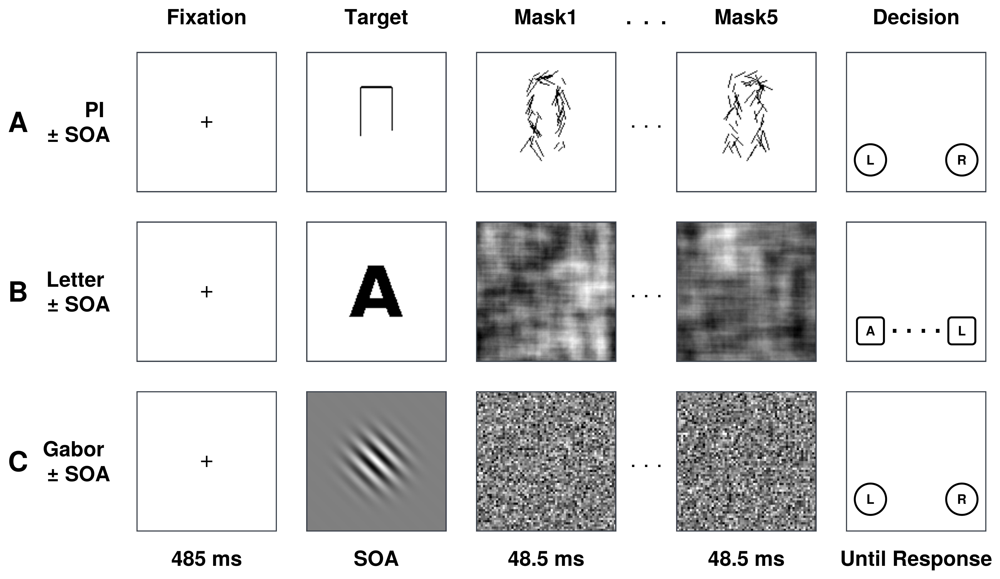
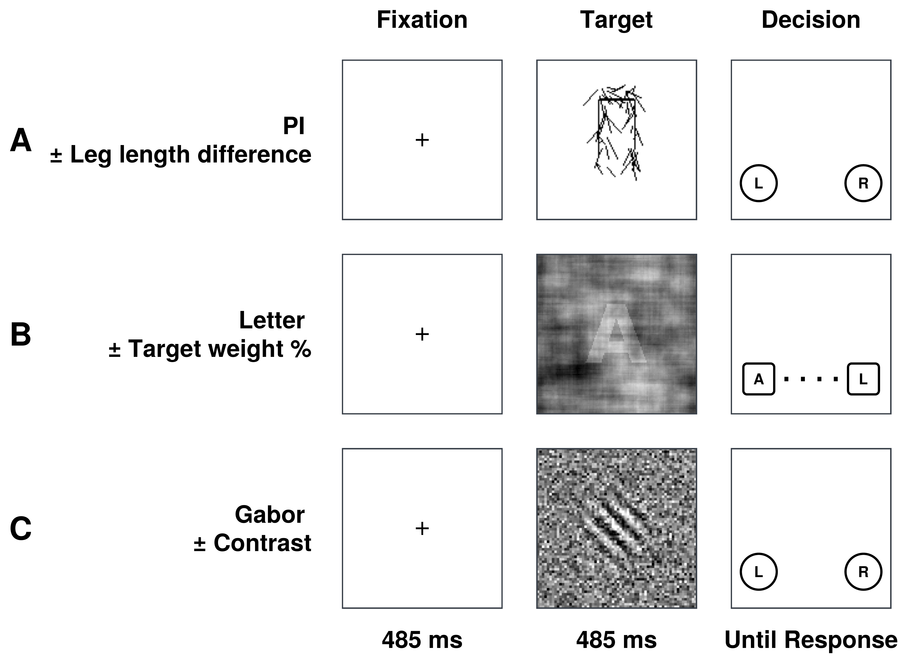
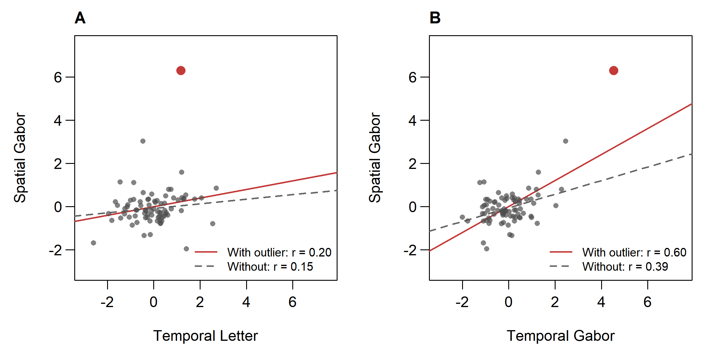
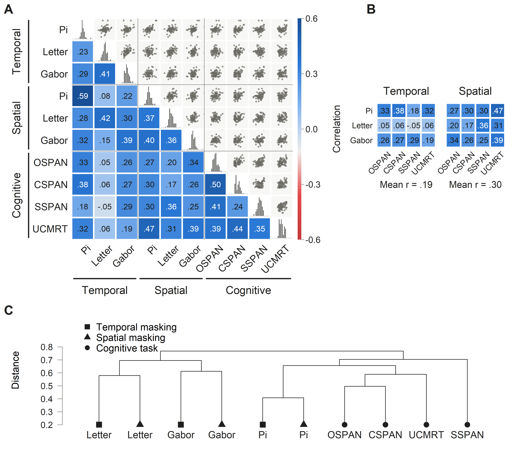
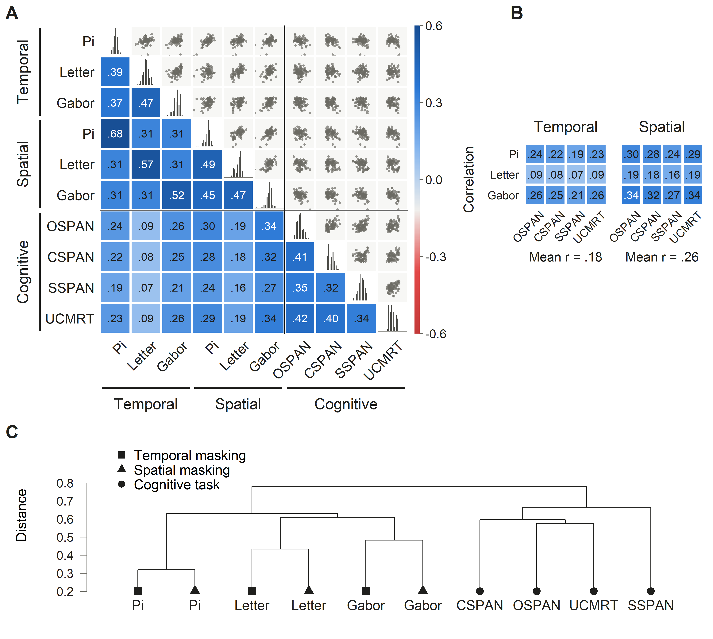

```{r}
knitr::opts_chunk$set(
  echo = FALSE, 
  message=FALSE, 
  warning = FALSE)
```

```{r temporal, echo = FALSE, fig.cap = "Trial sequence of the temporal-masking tasks. Panels A-C show the Pi, Letter, and Gabor tasks. After a fixation cross (485 ms) and the target, a variable stimulus onset asynchrony (SOA) elapsed before the target was replaced by five masks (48.5 ms each): line segments (Pi), frequency-matched letter noise (Letter), or white noise (Gabor). Participants judged which leg of the Pi was longer, which of nine letters (A-L) was shown, or whether the Gabor was tilted left or right. Difficulty was adjusted by varying the SOA.", out.width = "100%"}

```

```{r spatial, echo = FALSE, fig.cap = "Trial sequence of the spatial-masking tasks. Panels A-C show the Pi, Letter, and Gabor tasks. After a fixation cross (485 ms), the target was presented together with the same mask as in the temporal-masking tasks (485 ms). Participants made the same judgments. Difficulty was adjusted by varying the leg-length difference (Pi), the target weight in the letter-noise blend (Letter), or the contrast (Gabor).", out.width = "100%"}

```

```{r leverage, echo = FALSE, fig.cap = "Leverage of one outlying individual (red) on task correlations. Each panel plots two perceptual tasks against each other. Lines are least-squares fits with (solid) and without (dashed) the outlier. The outlier changes the correlation little in Panel A but substantially in Panel B.", out.width = "100%"}

```

```{r summary, echo = FALSE, fig.cap = "Observed correlations among the 10 tasks, computed from each individual's summary scores. (A) Correlation matrix of the six perceptual tasks and four cognitive tasks, with score histograms on the diagonal and scatterplots above it. (B) Correlations between each perceptual task and each cognitive task, shown separately for temporal-masking and spatial-masking tasks, with the mean correlation for each. (C) Hierarchical clustering of the 10 tasks.", out.width = "100%"}

```

```{r sem, echo = FALSE, fig.align = "center", fig.cap = "Model-implied correlations among the 10 tasks, based on the posterior of the hierarchical model. (A) Posterior mean correlation matrix of the six perceptual tasks and four cognitive tasks,  with score histograms on the diagonal and scatterplots above it. (B) Model-implied correlations between each perceptual task and each cognitive task, shown separately for temporal-masking and spatial-masking tasks, with the mean correlation for each. (C) Hierarchical clustering of the 10 tasks based on the model-implied correlations.", out.width = "100%"}

```
# Introduction

One of the most striking findings in individual-differences research is that performance on simple perceptual tasks predicts performance on cognitive tasks such as working memory and fluid intelligence tasks [@Jastrzebski.etal.2021; @Tsukahara.etal.2020; @Robison.etal.2026a]. The finding is old, perhaps first explored by @Galton.1883 and @Spearman.1904. Perhaps the best documented link between perceptual ability and higher-order cognition comes from the inspection time (IT) task. The classic version of the task is shown in Figure \@ref(fig:temporal)A. Here, individuals briefly view a simple figure and make a perceptual judgment. The brief display of the simple figure is followed by a pattern mask such that the visual information is available for a limited time. Consequently, accuracy is not at ceiling [@Vickers.etal.1972a]. Individuals with higher accuracy on these inspection-time tasks tend to score higher on tests of intelligence [@Nettelbeck.Lally.1976a; @Deary.Stough.1996], with a meta-analytic correlation of about $.3$ across 92 studies [@Grudnik.Kranzler.2001; @Kranzler.Jensen.1989a].

Why should accurate judgment about brief displays be related to high performance in working memory and IQ tasks? The standard answer is based on *processing speed*. People who do well on the IT task are good at extracting visual information quickly. They have fast visual processing speed. The claim then is that processing speed is not domain specific but is a general phenomenon that affects many cognitive processes [@Vernon.1983; @Salthouse.1996; @Jensen.2006]. Individuals with fast processing speed do well in cognitive tasks because it is general. The processing speed account of the correlation makes sense. Yet, we worry here about the claim that inspection time indexes processing speed *per se*. Certainly, it is plausible that individual differences in inspection time tasks reflect processing speed, but, on the other hand, they may reflect factors that do not have a temporal basis. We refer to these as spatial factors, in contrast to the temporal factor of processing speed: the ability to resolve the target clearly and to filter it from the mask. In the modern literature, perceptual abilities that are not time limited also correlate with intelligence and working memory [@Mosing.etal.2014; @Mikellidou.etal.2023; @Deary.etal.2004; @Tsukahara.etal.2020]. A good example of this correlation comes from @Tsukahara.etal.2020 who measured how well individuals could discriminate between the loudness of tones, the pitch of tones, the length of lines, and the area of circles. These discrimination abilities correlated between .16 and .53 with progressive matrix reasoning tasks. These findings do not rule out a processing speed explanation *per se* as these tasks may require speediness in maintaining representations across different fixations and attentional moments for comparison.

In practice, it seems difficult to determine if the correlation between perception and higher-order cognition is mediated by temporal or spatial factors. The reasons for these difficulties may be seen in the recent study by @Jastrzebski.etal.2021 who administered a series of IT tasks, a series of sensory discrimination tasks, and a battery of working memory and intelligence tasks to the same participants. There are both statistical and methodological reasons for the difficulty. The statistical reason is that the correlations form an almost perfect triangle of values: the latent inspection-time factor correlated about $.63$ with the latent sensory-discrimination factor, and each correlated substantially with working memory (*r* = $.68$ between inspection-time and working memory, and *r* = $.66$ between sensory-discrimination and working memory). Yet such a triangle tells us little about why perception relates to cognition. The methodological problem is that the stimuli in inspection time and sensory discrimination are not matched or yoked. In @Jastrzebski.etal.2021, they used partly different judgments (e.g., length vs. brightness) and partly different stimuli (e.g., lines vs. rectangles) for two kinds of tasks, so their relation to cognition may reflect specific judgments or stimuli rather than temporal or spatial factors.

Our goal is to put spatial and temporal factors in contrast and ask which factor better mediates the correlation with higher-order cognition. For the purposes herein, we distinguish between *fast eyes* and *sharp eyes*. Individuals with fast eyes process visual information quickly; people with sharp eyes process spatial information well in the presence of visual noise. If the fast-eyes account is correct, the relation between IT and cognitive performance arises because the temporal mask limits the time available to process the target. Remove this time limit, and the relation should disappear. On the other hand, if the sharp-eyes account is correct, then the relation reflects the ability to see under impoverished visual conditions. Improve the visual conditions, and the relation should disappear.

These diverging predictions may be tested in a highly controlled environment where only the masking type differs. In the *temporal-masking* tasks, the stimuli were relatively clear and the key manipulation was the time between the stimulus and a following patterned temporal mask. In the *spatial-masking* tasks, the stimulus was presented in stimulus-tuned noise, and the stimulus was displayed for a sufficient time. In the temporal-masking task, the duration of information is manipulated and individual differences rely more on processing speed (fast eyes) than acuity (sharp eyes). In the spatial-masking task, the amount of noise is manipulated and individual differences rely more on acuity than processing speed. Key in this setup is that all other aspects of the stimulus are fairly constant across temporal-masking and spatial-masking tasks. Thus, the experiment has the potential to discriminate between the fast-eyes and sharp-eyes hypotheses.

We constructed six different perceptual tasks by crossing three stimulus types with the two masking types. The two masking types differ in whether the stimulus is degraded by temporal masking or by spatial masking. The three stimulus types are a "Pi" stimulus, which is standard in inspection time tasks, a letter stimulus, and a Gabor grating. The Pi stimulus consists of two vertical segments connected by an upper horizontal segment, and the participant judges whether the left or right leg is longer. Letter stimuli are just these, and the participant judges which letter is presented. Gabor stimuli have an orientation that is either -45 degrees from the vertical (left tilting) or +45 degrees from the vertical (right tilting). Participants judge whether the Gabor orientation is left or right tilting.

The expected data patterns are as follows: if the fast-eyes hypothesis holds, then the three temporal-masking tasks should cluster well and the combined latent variable should correlate well with cognitive tasks. Conversely, if the sharp-eyes hypothesis holds, then the three spatial-masking tasks should cluster well and the combined latent variable should correlate well with cognitive tasks. Yet, there are data patterns that do not accord with either hypothesis. Perhaps, there is no special concept of fast or sharp eyes. An alternative is that some people have better vision than others, and that those with better vision tend to do better on higher-order cognition. We call this the *good-eyes* hypothesis.

Given the large literature on the correlation between inspection time and IQ, we ran this experiment to confirm that processing speed was crucial. We fully expected the temporal-masking tasks to cluster and the shared variance among them to drive the correlation between perception and higher-order cognition. We were quite wrong in these expectations. To foreshadow, we find that the distinction between spatial and temporal masking accounts for relatively little of the variance across individuals. A factor that accounts for more variance is stimulus type. It seems that people vary more across Gabors, letters, and Pi stimuli than they do across spatial and temporal masking types. Moreover, it seems that it is what is shared across the stimulus types that drives the correlation with higher-order cognition. And this fact provides the best evidence that neither spatial nor temporal masking is privileged in relating to higher-order cognition. It seems the good-eyes hypothesis, our add-on hypothesis for completeness, best describes the data.

# Experimental Method

The experimental battery consisted of 10 tasks that were run on 83 participants. Six of the 10 tasks are discussed above and serve as the perceptual part of the battery. These six are formed by crossing the stimulus type (Pi, letter, Gabor) with masking type (spatial, temporal). Of the remaining four tasks, three are span tasks to assess working memory and a fourth is a matrix reasoning task to assess fluid intelligence.

## Participants

Eighty-three undergraduate students at the University of California, Irvine, participated in exchange for \$50 in total compensation. Four participants withdrew before completing all sessions, leaving a final sample of 79. All participants reported normal or corrected-to-normal vision and provided informed consent. The study was approved by the Institutional Review Board of the University of California, Irvine (Study ID: STUDY00000064).

## Apparatus

Participants were tested individually in a dimly lit cubicle, seated approximately 100 cm from a 24-inch BenQ LED gaming monitor (1920 × 1080 pixels, 165 Hz refresh rate, 6.06 ms per frame). Stimuli were generated with PsychoPy3 [@Peirce.etal.2019] in Python 3.8, running on a PC with Lubuntu Linux 22.04.

## Tasks

**Task 1: Pi Stimuli with Temporal Masking.** Participants completed a two-alternative forced-choice length discrimination task on a $\Pi$-shaped (Pi) target, as shown in Figure \@ref(fig:temporal)A. Each trial began with the presentation of a fixation cross, which was displayed for 485 ms. It was followed by a centrally presented $\Pi$ stimulus in which one of the two vertical "legs" was longer than the other. After a variable stimulus onset asynchrony (SOA), the target was replaced by a dynamic sequence of five masks, each presented for 48.5 ms. Each mask was composed of random oblique line segments forming a $\Pi$-like clutter. Short line elements (randomized in length and orientation) were placed in two vertical columns aligned with the legs of the $\Pi$ and around the crossbar region. Participants judged whether the left or right leg was longer by pressing designated keys on the keyboard. The SOA was manipulated adaptively on a trial-by-trial basis for each participant.

**Task 2: Letter Stimuli with Temporal Masking.** Participants completed a 9-choice letter identification task as shown in Figure \@ref(fig:temporal)B. The presented letters were "A", "S", "D", "F", "G", "H", "J", "K", and "L", that is, those that are on the second row of a standard American English QWERTY keyboard. Each trial began with the presentation of a fixation cross, which was displayed for 485 ms. It was followed by a centrally presented target letter. After a variable SOA, the target was replaced by a dynamic sequence of five masks, each presented for 48.5 ms. The masks were FFT-filtered noise with spatial frequencies matching the collection of letters [@Parish.Sperling.1991]. Participants identified the letter by pressing the corresponding key on the keyboard. The SOA was manipulated adaptively on a trial-by-trial basis for each participant.

**Task 3: Gabor Stimuli with Temporal Masking.** Participants completed a two-alternative forced-choice orientation discrimination task as shown in Figure \@ref(fig:temporal)C. Each trial began with the presentation of a fixation cross, which was displayed for 485 ms. It was followed by a centrally presented Gabor patch with a random phase and an orientation of $+45^\circ$ or $-45^\circ$ relative to vertical. The patch subtended approximately $8.1^\circ \times 8.1^\circ$ of visual angle and had a spatial frequency of approximately 1.2 cycles per degree, with a Gaussian envelope of standard deviation of approximately $1.0^\circ$. After a variable SOA, the target was replaced by a dynamic sequence of five white noise masks, each presented for 48.5 ms. Participants judged whether the grating was tilted leftward ($-45^\circ$) or rightward ($+45^\circ$) by pressing designated keys on the keyboard. The SOA was manipulated adaptively on a trial-by-trial basis for each participant.

**Task 4: Pi Stimuli with Spatial Masking.** This task matched the temporal Pi-leg discrimination task (Task 1), as shown in Figure \@ref(fig:spatial)A, except that the mask was presented together with the target rather than after it. Each trial began with the presentation of a fixation cross, which was displayed for 485 ms. It was followed by the $\Pi$ target superimposed on a $\Pi$-like clutter mask constructed in the same way as in Task 1, and this target-mask combination was presented for 485 ms. Participants judged whether the left or right leg was longer by pressing designated keys on the keyboard. Instead of the SOA, the leg-length difference was manipulated adaptively on a trial-by-trial basis for each participant.

**Task 5: Letter Stimuli with Spatial Masking.** This task matched the temporal letter identification task (Task 2), as shown in Figure \@ref(fig:spatial)B, with the same nine letters and response keys, except that the target letter was embedded in noise rather than followed by a mask. Each trial began with the presentation of a fixation cross, which was displayed for 485 ms. It was followed by a target letter presented in FFT-filtered noise with spatial frequencies matching the collection of letters, and this stimulus-noise combination was presented for 485 ms. Instead of the SOA, the contrast of letter-to-noise was manipulated adaptively on a trial-by-trial basis for each participant.

**Task 6: Gabor Stimuli with Spatial Masking.** This task matched the temporal Gabor orientation discrimination task (Task 3), as shown in Figure \@ref(fig:spatial)C, except that the Gabor patch was embedded in noise rather than followed by a mask. Each trial began with the presentation of a fixation cross, which was displayed for 485 ms. It was followed by a Gabor patch with the same size, spatial frequency, and envelope as in Task 3, with a random phase and an orientation of $+45^\circ$ or $-45^\circ$ relative to vertical, presented in white noise. This stimulus-noise combination was presented for 485 ms. Participants judged whether the grating was tilted leftward ($-45^\circ$) or rightward ($+45^\circ$) by pressing designated keys on the keyboard. Instead of the SOA, the Gabor contrast was manipulated adaptively on a trial-by-trial basis for each participant.

**Task 7: OSPAN.** Participants completed an automated OSPAN task [@Unsworth.etal.2005] combining simple math operations with working memory recall for letter sequences. Each set contained 3–7 letters, with each set size presented three times, yielding 15 memory sets in total. Before the main task, participants completed three practice sets of size three to familiarize themselves with the procedure. In the main task, set sizes 3–7 were each presented three times in randomized order (15 sets total). Within each set, trials alternated between (i) a math operation screen (e.g., “6 + 2 = ?”), after which the participant clicked to continue, and (ii) a proposed answer screen showing a single digit; participants judged whether the digit correctly solved the operation by clicking true/false. A single uppercase letter was then shown for 800 ms, and the sequence continued until the set ended. At recall, participants clicked the letters in serial order from a matrix. For each set, participants earned points equal to the set size only if (a) all math operations were solved within the participant's mean solving time in the practice trials plus 2.5 SD, (b) no math errors occurred for that set, and (c) all letters were recalled in the correct order. Sets failing any criterion scored 0. The final OSPAN score was the sum of points across all sets.

**Task 8: CSPAN.** Participants completed a CSPAN task [@Conway.etal.2005] combining serial counting with working memory recall for number sequences. Each display contained a set of target items (green circles) intermixed with distractors (yellow circles). Participants counted the number of targets in each display, after which the participant clicked to continue to the next display. At recall, participants were prompted to recall the sequence of counts (e.g., “3–5–2”) in the exact order they were encountered. Responses were made by clicking the digits from a matrix. The procedure began with three practice sets of size 2. The main task then presented set sizes 3–7, each three times in randomized order (15 sets total). A set contributed points equal to its size only if the final recall sequence was accurate in both values and order. The final CSPAN score was the sum of points across all sets.

**Task 9: SSPAN.** Participants completed an SSPAN task adapted from the Corsi block-tapping paradigm to assess both storage and processing aspects of spatial working memory [@Pahor.etal.2022a]. On each trial, cartoon gophers appeared sequentially in one of 12 possible screen locations, each presented for 1,500 ms with a 500 ms inter-stimulus interval. Participants were required to reproduce the sequence by tapping the corresponding locations in the exact order. Between each gopher presentation, participants performed a secondary sorting task, dragging an item to the left or right, thereby imposing concurrent processing demands and limiting reliance on mnemonic strategies. Sequence length ranged adaptively from 2 to 10 items, increasing or decreasing in difficulty depending on accuracy. The final SSPAN score was the total successfully recalled items across all sets.

**Task 10: UCMRT.** Participants completed the UCMRT [@Pahor.etal.2019], a measure of fluid intelligence modeled after Raven’s Progressive Matrices. Each trial presented a 3×3 matrix of abstract visual patterns with the bottom-right cell missing, and participants selected the option that best completed the matrix from eight alternatives displayed below. UCMRT was chosen because it was especially developed for young adults with above-average performance on matrix reasoning tasks, providing a more sensitive and efficient assessment of individual differences in fluid intelligence in this population. The task consisted of 23 problems of varying difficulty, including 2 two-relation items, 3 three-relation items with a single transformation, 6 three-relation items with two transformations, 6 three-relation items with three transformations, and 6 logic items. Performance was scored as accuracy, defined by the number of correctly solved matrices.

## Procedure

The experiment consisted of three sessions of approximately one hour each, conducted on separate days within one week. Each session consisted of three phases, denoted here Phase I, Phase II, and Phase III. Phase I consisted of the six perceptual tasks (Task 1–6). Each task was shown in a single block of 50 trials. All six tasks were performed for 50 trials each, and the ordering of the tasks was random across days and participants. Phase III was the same; and across Phase I and Phase III, 100 trials per perceptual task were performed. These phases were repeated on all three sessions, yielding 300 trials per participant per perceptual task. This number is quite large compared to other individual-differences studies using perceptual tasks. In these phases and blocks, the difficulty was manipulated in an adaptive fashion. Two staircases were run interleaved; one was a 2D-1U staircase with an asymptotic limit of .707; the other was a 3D-1U staircase with an asymptotic limit of .794 [@Levitt.1971]. The first perceptual block served as practice and was excluded from analysis, leaving 250 trials per task (125 per staircase) and 1,500 perceptual trials per individual for analysis.

Phase II of each session was reserved for the working memory and matrix reasoning tasks. The OSPAN task was performed in Phase II on Session 1; the CSPAN task was performed likewise on Session 2; the SSPAN and UCMRT were performed on Session 3.

# Summary-Score Analysis and Results

We analyzed the data in two ways. The first is a conventional analysis of summary scores. For each individual and task, we computed a single score, screened these scores for outliers, and examined the correlations among tasks. This analysis is simple and transparent, and it lets readers see the data directly. The second is a hierarchical psychometric model fit to the trial-level data. It estimates the relations among tasks while accounting for trial-to-trial noise, so that the estimated correlations are not attenuated and their uncertainty reflects both the sampling of trials and the sampling of individuals. The model also decomposes individual differences into general, masking-specific, and stimulus-specific sources, each of which is related to cognitive performance. The summary-score analysis serves as a descriptive first look, and the hierarchical model provides a more complete accounting of the data.

The first step in the summary-score analysis is constructing a single score that summarizes performance on each task for each individual. For the three temporal-masking tasks, the main independent variable is the stimulus onset asynchrony between the target and the mask, which was manipulated adaptively in staircase fashion. For the three spatial-masking tasks, the main independent variables are the leg-length difference of the Pi stimulus, the target weight in the letter–noise blend, and the contrast of the Gabor patch, each of which was likewise manipulated adaptively. To construct these summary scores, the mean duration across the last 150 analyzed trials was computed. For the four cognitive tasks, Tasks 7–10, the scoring method is standard to the task and described above.

The main target of the summary-score analysis is the correlations between tasks across individuals. The main concern in data quality is that some scores exert unreasonably high leverage on these correlations. Figure \@ref(fig:leverage) shows two scatterplots of individual scores, each plotting one task against another. Both include the same outlying individual. In Figure \@ref(fig:leverage)A, this individual does not change the correlation appreciably; in Figure \@ref(fig:leverage)B, the individual does. We decided the best approach was to discard any score on a task that was more than 4 standard deviations from the task mean, regardless of its effect on the correlations. In total, data from two task-by-individual combinations (out of a total of 790 combinations) were discarded. Readers can access the raw data and freely explore and visualize the data through the OSF repository: <https://osf.io/pzk35/overview?view_only=ae109a862cb54e74ba9fcedbeddbe069>.

The surface-level results are shown in Figure \@ref(fig:summary). Panel A shows the correlations between tasks, and these are about .29 on average: .32 among the six perceptual tasks, .39 among the four cognitive tasks, and .25 between perceptual and cognitive tasks. To interpret the pattern of these surface correlations vis-à-vis the hypotheses, we simply replot the correlations between the temporal-masking tasks and the cognitive tasks and the correlations between the spatial-masking tasks and the cognitive tasks. The two submatrices are shown in Panel B, and to our surprise the correlations are larger for spatial-masking tasks than for temporal-masking tasks (mean *r* = .30 vs. .19). Thus, at the level of surface correlations, neither masking type is clearly privileged in its relation to higher-order cognition.

To see directly how the tasks group together, we used hierarchical clustering with average linkage [@Sokal.Michener.1958], as implemented in the hclust function in R, with $1 - r$ as the distance between two tasks. The results are shown in Figure \@ref(fig:summary)C. In this representation, tasks that are more similar are presented together lower in the hierarchy. In all cases, the most similar perceptual tasks are arranged by stimulus type---Gabor grating, letters, and Pi stimuli---and not by masking type. For example, temporal masking in the Gabor stimuli is quite dissimilar to temporal masking in the Pi stimuli. Perhaps the only unexpected finding then is that the Pi stimuli are dissimilar to the other perceptual tasks even though the only difference is the stimulus type. As it turns out, when a more complete accounting of the data through hierarchical modeling is performed next, this unexpected finding does not hold.

# Hierarchical Psychometric Model Analysis

The summary-score analysis has three limitations. First, the correlations are attenuated, because each score contains trial-to-trial noise in addition to an individual’s true ability [@Spearman.1904; @Rouder.Haaf.2019]. Second, their uncertainty is miscalculated, because it reflects only the sampling of individuals and not the sampling of trials. Third, the correlations alone cannot distinguish among the fast-eyes, sharp-eyes, and good-eyes hypotheses, because these hypotheses concern which source of shared variance carries the relation to cognitive performance. To address all three, we estimated individual thresholds and their relations simultaneously from trial-level data with a hierarchical psychometric model [@Rouder.Mehrvarz.2026]. Because the model accounts for trial-to-trial noise, the estimated correlations are not attenuated and their uncertainty reflects both sources of variability; and because the latent level decomposes individual differences into general, masking, and stimulus factors, the model directly tests which source relates to cognitive performance.

The hierarchical model has three levels. The top level is termed here the *data level*, and it describes how trial data in the perceptual tasks reflect individuals' true perceptual abilities. The next level, termed the *measurement level*, describes how these individual true scores reflect a factor structure where the factors are stimulus type, masking type, general visual factor, and higher-order cognition. The final level, termed the *structural level*, describes the association between factors, and in particular, it describes how the cognitive tasks are related to the perceptual abilities. We describe each level in turn.

**Data level.** To specify levels, we need to introduce some notation. The data level is for the perceptual tasks and it describes how trial-level performance reflects true perceptual abilities. Let $i = 1,\dots,I$ denote an individual, let $j \in \{1,2,3,4,5,6\}$ denote the perceptual task, and let $k = 1,\dots,K_{ij}$ denote the trial for the $i$th individual on the $j$th task. Let $y_{ijk}$ denote the corresponding accuracy, $y_{ijk}=0,1$ for error or correct responses, respectively. A lognormal psychophysical data model [@Rouder.Mehrvarz.2026] is $$y_{ijk} \sim \text{Bernoulli}\!\left(\Phi\!\left(\beta_j\,(s_{ijk}+\theta_{ij})\right)\right),$$ where $\Phi(\cdot)$ denotes the standard normal cumulative distribution function. The variable $s_{ijk}$ denotes the **strength** of the stimulus defined as follows: On each trial, there is a natural stimulus intensity variable. For example in temporal-masking tasks, this intensity is stimulus duration measured in milliseconds. The strength is the log of this duration. Taking the log has two degrees of freedom, the base and a multiplier which serves as a referent. To set these degrees of freedom in a consistent way, we simply took the z-score of log intensity where setting mean and variance of the log scores is equivalent to picking a base and referent. Hence, strength here is the standardized logarithm of a natural intensity variable. Please see @Rouder.Mehrvarz.2026 for additional discussion.

There are two parameters in the above psychophysical model: $\theta_{ij}$ and $\beta_j$. The parameter $\theta_{ij}$ denotes the latent ability of individual $i$ on task $j$, expressed on the same scale as $s_{ijk}$, and $\beta_j$ denotes the rate of the psychometric function on strengths for task $j$.

**Measurement level.** The measurement level describes how true abilities reflect specific factors. Each individual’s perceptual abilities are characterized by the vector $\boldsymbol{\theta}_i=(\theta_{i1},\ldots,\theta_{i6})'$. Because the scale of each $\theta_{ij}$ is set by the stimulus units of task $j$, and is therefore arbitrary across tasks, we work with standardized abilities:

$$\theta_{ij} = \mu_j + \sigma_j\,\theta^*_{ij}, \qquad \operatorname{Var}(\theta^*_{ij}) = 1, \qquad j = 1,\ldots,6,$$
where $\mu_j$ and $\sigma_j$ absorb the location and scale of each task. Individuals also performed in the cognitive tasks but the scoring rules are standard and do not reflect a trial structure. Let $\boldsymbol{c}^*_i=(c^*_{i1},\ldots,c^*_{i4})'$ be the vector of each individual’s standardized cognitive performance. A complete vector of standardized abilities on the 10 tasks, denoted $\boldsymbol{\gamma}^*_i$, is:

$$\boldsymbol{\gamma}^*_i = \left(\boldsymbol{\theta}^{*\prime}_i,\boldsymbol{c}^{*\prime}_i\right)'.$$
The next task is to define a reduced set of factors that capture the design and hypotheses. We specify seven factors as follows: a general visual factor, a factor that reflects temporal masking, a factor that reflects spatial masking, a factor that reflects Pi stimuli, a factor that reflects letter stimuli, a factor that reflects Gabor stimuli, and a factor that reflects higher-order cognition.

The standard factor model is used to relate factors to standardized abilities:

$$\boldsymbol{\gamma}^*_i = \boldsymbol{\Lambda}\,\boldsymbol{\eta}_i + \boldsymbol{\epsilon}_i, \qquad \boldsymbol{\epsilon}_i \sim \mathcal{N}_{10}\!\left(\mathbf{0}, \boldsymbol{\Delta}\right), \qquad \boldsymbol{\Delta} = \operatorname{diag}\!\left(\delta_1^2, \ldots, \delta_{10}^2\right),$$
where $\boldsymbol{\Lambda}$ is a $10 \times 7$ matrix of factor loadings, $\boldsymbol{\eta}_i$ is a 7-dimensional vector of latent factors for the $i$th individual, and $\boldsymbol{\epsilon}_i$ is a residual with task-dependent variance. Because the loadings are defined on standardized abilities, equal loadings mean an equal proportion of variance in every task, independent of units. The key constraints are on the factor loadings, given as follows: 
$$
\boldsymbol{\Lambda} =
\bordermatrix{
 & \text{General visual} & \text{Temporal} & \text{Spatial} & \text{Pi} & \text{Letter} & \text{Gabor} & \text{Cognitive} \cr
 & \lambda_{1} & \lambda_{12} & 0 & \lambda_{4} & 0 & 0 & 0 \cr
 & \lambda_{1} & \lambda_{22} & 0 & 0 & \lambda_{5} & 0 & 0 \cr
 & \lambda_{1} & \lambda_{32} & 0 & 0 & 0 & \lambda_{6} & 0 \cr
 & \lambda_{1} & 0 & \lambda_{43} & \lambda_{4} & 0 & 0 & 0 \cr
 & \lambda_{1} & 0 & \lambda_{53} & 0 & \lambda_{5} & 0 & 0 \cr
 & \lambda_{1} & 0 & \lambda_{63} & 0 & 0 & \lambda_{6} & 0 \cr
 & 0 & 0 & 0 & 0 & 0 & 0 & \lambda_{77} \cr
 & 0 & 0 & 0 & 0 & 0 & 0 & \lambda_{87} \cr
 & 0 & 0 & 0 & 0 & 0 & 0 & \lambda_{97} \cr
 & 0 & 0 & 0 & 0 & 0 & 0 & \lambda_{10,7}
}.$$

Here is how the factor loadings work. Each row is for a particular task, and the first row is for Task 1, the Pi stimulus with temporal masking. The first factor is the general visual factor for the perceptual tasks and there is a positive valued loading, $\lambda_{1}$, for this task and factor. The second and third factors are for temporal and spatial masking tasks, respectively, and whereas this task is temporal and not spatial, there is a positive loading $\lambda_{12}$ and a zero loading on the spatial factor. The fourth, fifth, and sixth factors are for Pi, letter, and Gabor stimuli, respectively, and consequently, there is a positive loading $\lambda_{4}$ and zero loadings on the letter and Gabor factors. The last factor is for cognitive tasks, and hence, there is a zero loading on it. The remainder of the rows are evaluated analogously. Two sets of equality constraints are imposed: the general loading $\lambda_1$ is shared by all six perceptual tasks, and each stimulus loading ($\lambda_4$, $\lambda_5$, $\lambda_6$) is shared by the temporal and spatial versions of the same stimulus; the masking loadings are free. These equalities are needed for identification.

The above factor loadings define a standard bifactor model for the six perceptual
tasks. The first factor is the general visual factor across the six perceptual tasks; the next five factors define specific effects of masking type and stimulus type. The next level leverages this bifactor representation to provide specific assessments of the fast-eyes, sharp-eyes, and good-eyes hypotheses as discussed next.

**Structural level.** The structural model describes how cognitive performance relates to the perceptual abilities across individuals. The key constraint is on $\boldsymbol{\eta}_i$, each individual's 7-dimensional profile of abilities. In structural equation models, these abilities are related through regression equations. We follow a standard notation in structural equation modeling [SEM; @Bollen.1989]. Readers in cognition should note that this notation, while standard, is a bit strange. The structural part of the model is given by $$\boldsymbol{\eta}_i = \mathbf{B}\,\boldsymbol{\eta}_i + \boldsymbol{\zeta}_i, \qquad
\boldsymbol{\zeta}_i \sim \mathcal{N}_{7}\!\left(\mathbf{0}, \mathbf{I}\right)$$ The strange-looking part is $\boldsymbol{\eta}_i = \mathbf{B}\,\boldsymbol{\eta}_i + \boldsymbol{\zeta}_i$, which at first glance seems self-referential or recursive. It is not, because there are strict constraints on $\mathbf{B}$, which is also known as the path matrix in SEM analysis. For our hypotheses, the appropriate specification of $\mathbf{B}$ is: $$\mathbf{B} =
\begin{pmatrix}
0 & 0 & 0 & 0 & 0 & 0 & 0\\
0 & 0 & 0 & 0 & 0 & 0 & 0\\
0 & 0 & 0 & 0 & 0 & 0 & 0\\
0 & 0 & 0 & 0 & 0 & 0 & 0\\
0 & 0 & 0 & 0 & 0 & 0 & 0\\
0 & 0 & 0 & 0 & 0 & 0 & 0\\
b_1 & b_2 & b_3 & b_4 & b_5 & b_6 & 0
\end{pmatrix}.$$ Only the last row contains nonzero parameters, so the cognitive factor is the only factor that receives paths from the other factors. This specification then implies $\eta_{i7} = \sum_{\ell=1}^{6} b_\ell\,\eta_{i\ell} + \zeta_{i7}$, where $\ell$ indexes the six perceptual factors. This specification ensures that the perceptual factors are orthogonal (any correlation is accounted for by the general visual factor) and that the effects of each perceptual factor on the cognitive factor are separately indexed by $b_1,\ldots,b_6$.

Two constraints are placed on these weights:
$$(\lambda_{12}+\lambda_{22}+\lambda_{32})\,b_2 + (\lambda_{43}+\lambda_{53}+\lambda_{63})\,b_3 = 0, \qquad \lambda_4 b_4 + \lambda_5 b_5 + \lambda_6 b_6 = 0.$$

These constraints contrast-code the masking and stimulus effects. As a result, $b_1$ carries the link common to all six perceptual tasks, and $b_2,\ldots,b_6$ capture deviations from it. Under the constraints, $b_3$ and $b_6$ are determined by the other weights, and $b_1$, $b_2$, $b_4$, and $b_5$ are free.


How does this structural equation component capture the fast-eyes, sharp-eyes, and good-eyes hypotheses? If cognitive performance covaries uniquely with temporal masking abilities, that is, the fast-eyes hypothesis holds, then regression weight $b_2$ should be large and positive. Likewise, if cognitive performance uniquely covaries with spatial masking abilities, that is, the sharp-eyes hypothesis holds, then regression weight $b_3$ should be large and positive. Finally, if masking type has little differential effect, that is, the good-eyes hypothesis holds, then $b_1$ should be large and $b_2$ (and hence $b_3$) should be near zero. The regression weights $b_4$, $b_5$, and $b_6$ refer to the effect of stimulus type, and people who do differentially well on specific stimulus types may do well on cognitive tasks.


# Model-Based Analysis

```{r bifactor-post, include = FALSE}
library(R2jags)
library(papaja)

fit <- readRDS("Data/sem_trace.rds")
sl  <- fit$BUGSoutput$sims.list

# tasks   = TPi, TLetter, TGabor, SPi, SLetter, SGabor
# factors = V, Bwd, Spa, Pi, Letter, Gabor
tasks   <- c("Temporal Pi", "Temporal Letter", "Temporal Gabor",
             "Spatial Pi",  "Spatial Letter",  "Spatial Gabor")
vis     <- c("V", "Bwd", "Spa", "Pi", "Letter", "Gabor")
vis_lab <- c("General visual factor", "Temporal masking", "Spatial masking",
             "Pi stimulus", "Letter stimulus", "Gabor stimulus")

# formatting helpers
f2   <- function(x) sub("^-\\.00$", ".00", sub("^(-?)0\\.", "\\1.", sprintf("%.2f", x)))
ci   <- function(x) sprintf("%s [%s, %s]", f2(mean(x)), f2(quantile(x, .025)), f2(quantile(x, .975)))
pct  <- function(x) sprintf("%.0f%%", 100 * mean(x))
bold <- function(x) paste0("\\textbf{", x, "}")

# ---- Table 1: variance decomposition (standardized, so shares are proportions) ----
shV <- sl$share_gen      # identical across tasks (shared general loading)
shM <- sl$share_mask
shS <- sl$share_stim     # identical within stimulus (shared stimulus loading)
shU <- sl$share_uni
avgV <- rowMeans(shV); avgM <- rowMeans(shM); avgS <- rowMeans(shS); avgU <- rowMeans(shU)

tab_shares <- data.frame(
  Task            = c(as.character(1:6), bold("Average")),
  `Masking type`  = c(rep(c("Temporal", "Spatial"), each = 3), ""),
  `Stimulus type` = c(rep(c("Pi", "Letter", "Gabor"), times = 2), ""),
  General  = c(apply(shV, 2, ci), bold(ci(avgV))),
  Masking  = c(apply(shM, 2, ci), bold(ci(avgM))),
  Stimulus = c(apply(shS, 2, ci), bold(ci(avgS))),
  Unique   = c(apply(shU, 2, ci), bold(ci(avgU))),
  check.names = FALSE
)
p_S_gt_M <- mean(avgS > avgM)

# ---- Table 2: correlations and Bayes factors ----
bf_g  <- sl$b; colnames(bf_g)  <- vis     # b_1..b_6 (b_3, b_6 derived from constraints)
bf_gs <- sl$r; colnames(bf_gs) <- vis     # r_l with the cognitive factor

# Three tests (contrast coding): G: b1 = 0; M: b2 = 0 (=> b3 = 0); S: b4 = b5 = 0 (=> b6 = 0)
# Priors: bfree ~ N(0, 1) iid, so prior density at 0 is dnorm(0) (1-D) and dnorm(0)^2 (2-D)
bf10_file <- "Data/sem_bf10.rds"
if (file.exists(bf10_file) && identical(names(readRDS(bf10_file)), c("G", "M", "S"))) {
  bf10 <- readRDS(bf10_file)              # CMDE values (Morey et al., 2011) from SEM.Rmd
} else {
  # fallback: Savage-Dickey with kernel density estimates of the posterior at 0
  post0_1d <- function(x) { d <- density(x, n = 2^12); approx(d$x, d$y, xout = 0)$y }
  post0_2d <- function(x, y) {
    k <- MASS::kde2d(x, y, n = 201, lims = c(-1, 1, -1, 1) * max(abs(c(x, y))))
    k$z[which.min(abs(k$x)), which.min(abs(k$y))]
  }
  bf10 <- c(G = dnorm(0)   / post0_1d(bf_g[, "V"]),
            M = dnorm(0)   / post0_1d(bf_g[, "Bwd"]),
            S = dnorm(0)^2 / post0_2d(bf_g[, "Pi"], bf_g[, "Letter"]))
  warning("CMDE Bayes factors not found; using KDE Savage-Dickey approximation.")
}

bf10_fmt <- function(x) ifelse(x >= 10, formatC(x, format = "f", digits = 1, big.mark = ","),
                               sprintf("%.2f", x))
bf_txt   <- function(b10) sprintf("$\\text{BF}_{10} = %s$", bf10_fmt(b10))
r_ci     <- function(f) sprintf("*r* = %s, 95%% credible interval [%s, %s]", f2(mean(bf_gs[, f])),
                                f2(quantile(bf_gs[, f], .025)), f2(quantile(bf_gs[, f], .975)))

H0_col   <- c("$b_1 = 0$", "$b_2 = 0$", "", "$b_4 = b_5 = 0$", "", "")
bf10_col <- c(bold(bf10_fmt(bf10["G"])), bf10_fmt(bf10["M"]), "",
              bf10_fmt(bf10["S"]), "", "")

tab_cor <- data.frame(
  Factor = vis_lab,
  r      = unname(apply(bf_gs, 2, ci)),
  H0     = H0_col,
  BF     = bf10_col,
  row.names = NULL
)
names(tab_cor) <- c("Factor", "$r$", "$H_0$", "$\\text{BF}_{10}$")
```

The model is analyzed in the Bayesian framework using common Markov chain Monte Carlo methods [@Gelfand.etal.1992].  Priors on the remaining parameters, provided in Appendix A, are diffuse and have minimal impact on the posteriors.  The model was implemented in JAGS [@Plummer.2003] and run from R with the R2jags package. To overcome difficult mixing conditions, we ran four chains, each with 10,000 burn-in steps followed by 100,000 sampling steps. Chains were thinned by a factor of 10, yielding 40,000 pterior draws. Convergence was assessed with the Gelman--Rubin $\hat{R}$ statistic [@Gelman.Rubin.1992], which was below 1.01 for all parameters.  

## Manifest Correlation

The first analysis presents the model-based version of the summary-score analysis. Here, we derive the posterior manifest correlation matrix across the 10 tasks. The covariance form of this matrix, denoted $\boldsymbol{\Sigma}$, is a $10\times10$ matrix given by $\boldsymbol{\Sigma} = \boldsymbol{\Lambda}\mathbf{Q}\mathbf{Q}'\boldsymbol{\Lambda}' + \boldsymbol{\Delta}$, where $\mathbf{Q}=(\mathbf{I}-\mathbf{B})^{-1}$. The resulting values are shown in Figure \@ref(fig:sem)A. There are two main differences between these model-derived values and the summary-score correlations. First, the model-derived values are larger, reflecting a disattenuation of trial noise. Second, the model-derived values vary more smoothly, reflecting regularization from a reduced number of factors. Figure \@ref(fig:sem)B shows the submatrices for the fast-eyes and sharp-eyes hypotheses, and as can be seen, the cognitive tasks seem somewhat better associated with spatial-masking than temporal-masking tasks. Figure \@ref(fig:sem)C shows the hierarchical clustering of the model-estimated correlations. The first three merges each joined the temporal and spatial versions of the same stimulus, first Pi, then Letter, then Gabor, and only after these pairs had formed did they combine with one another. In contrast, neither the three temporal-masking tasks nor the three spatial-masking tasks formed a cluster of their own. Instead, all six perceptual tasks formed one cluster, and the four cognitive tasks formed a separate cluster that joined the perceptual tasks only at the final step. Thus, individual differences in perceptual task performance were organized primarily by stimulus type rather than by masking type.

## Bifactor Analysis of the Perceptual Tasks

The six perceptual tasks were modeled as a bifactor model with a general visual factor and unique factors for the two masking types and the three stimulus types. For each task, we may ask how much variance is accounted for by the general factor, the particular masking factor, and the particular stimulus factor. Formulas for computing the proportion of variance in a bifactor setup are easy to derive and well known [@Preacher.MacCallum.2003; @Reise.2012]. For our case, the key variance formula is:
$$\operatorname{Var}(\theta^*_{ij}) = \sum_{l=1}^{6} \Lambda_{jl}^2 + \delta_j^2
= \underbrace{\Lambda_{j1}^2}_{\text{general}}
+ \underbrace{\Lambda_{j2}^2 + \Lambda_{j3}^2}_{\text{masking}}
+ \underbrace{\Lambda_{j4}^2 + \Lambda_{j5}^2 + \Lambda_{j6}^2}_{\text{stimulus}}
+ \underbrace{\delta_j^2}_{\text{unique}} = 1 .$$
For example, for the first task, temporal masking with the Pi stimulus, $\operatorname{Var}(\theta^*_{i1}) = \lambda_{1}^2 + \lambda_{12}^2 + \lambda_{4}^2 + \delta_1^2 = 1$. Because the abilities are standardized, each component is directly the proportion of variance due to each source. Table \@ref(tab:tab-shares) provides the proportions. For example, the first row shows the proportion for Task 1, the temporal masking of Pi stimuli. The general visual factor accounts for 31% of the variance; the relevant masking factor accounts for only 4% of the variance; the relevant stimulus factor accounts for 37% of the variance; and 28% is unique to this task. Perhaps the most informative entry is the Average row, which shows that masking type accounts for relatively little variance in these tasks (15%, compared with 31% for the general visual factor and 27% for stimulus type). It seems that people vary on how good they are on all tasks, and how good they are differentially on the stimulus types. This finding is in accordance with the clustering results in Figure \@ref(fig:sem)C, but the degree of uncertainty for both finite numbers of individuals and trials is included.

```{r tab-shares, results = "asis"}
apa_table(
  tab_shares,
  caption = "Proportion of variance of each perceptual task due to each source.",
  note = "Values are posterior means with 95\\% credible intervals.",
  align = c("c", "l", "l", "c", "c", "c", "c"),
  escape = FALSE,
  font_size = "small"
)
```

## Association Between Perceptual Factors and Higher-Order Cognition: A Test of the Fast-Eyes, Sharp-Eyes, and Good-Eyes Hypotheses.

The hierarchical model is designed to assess the critical hypotheses directly. The pivotal quantities are the regression weights $b_1, \ldots, b_6$ in the structural model. One highly interpretable way of assessing these weights is to report the implied correlation between each of the six perceptual factors and cognitive performance. This correlation is given by $$
r_\ell = \frac{b_\ell}{\sqrt{\sum_{\ell'=1}^{6} b_{\ell'}^2 + 1}},$$ where $r_\ell$ is the correlation between the $\ell$th perceptual factor and the cognitive factor. Under the contrast coding of the structural model, $r_1$ captures the link common to all six perceptual tasks, and $r_2, \ldots, r_6$ capture deviations from it. The good-eyes hypothesis thus corresponds to a large value of $r_1$. The fast-eyes and sharp-eyes hypotheses correspond to a masking contrast: a large positive $r_2$ (and hence a negative $r_3$) for fast eyes, and the reverse for sharp eyes. These correlation values, along with credible intervals, are shown in Table \@ref(tab:tab-cor). The derivation of the correlation is provided in Appendix B.

To perform inference on these values, we used a Bayes factor model comparison approach. The main question is whether each source of perceptual variation (general, masking, or stimulus) is or is not related to the cognitive factor, and we did a separate model comparison test for each source. The Bayes factor is a ratio: it is the probability of the data under a model with a possible relation between the specified source and the cognitive factor, relative to the probability of the data under a model with no such relation. For the general visual factor, we tested $b_1 = 0$. For masking, we tested $b_2 = 0$, which by the constraint also implies $b_3 = 0$. For stimulus type, we tested $b_4 = b_5 = 0$, which also implies $b_6 = 0$. In each case the remaining weights were left free. Our computational approach was to use the Savage-Dickey ratio [@Dickey.Lientz.1970; @Wagenmakers.etal.2010]:

$$
\text{BF}_{10}^{G} = \frac{p(b_1 = 0)}{p(b_1 = 0 \mid \text{data})}, \qquad
\text{BF}_{10}^{M} = \frac{p(b_2 = 0)}{p(b_2 = 0 \mid \text{data})}, \qquad
\text{BF}_{10}^{S} = \frac{p(b_4 = b_5 = 0)}{p(b_4 = b_5 = 0 \mid \text{data})}.
$$

The Savage-Dickey ratio is evaluated from MCMC outputs using the CMDE method of @Chen.1994 [see @Morey.etal.2011a for details]. Values less than 1 indicate evidence for a null relation; values at 1 are equivocal; values greater than 1 are evidence for a substantial relation. Table \@ref(tab:tab-cor) shows these Bayes factors. One factor stands out: there is a substantial correlation ($r_1 = 0.64$, $\text{BF}_{10} \approx 10{,}413$) between the general visual factor, the one that captures what is in common in all the perceptual tasks, and higher-order cognition. The Bayes factors for masking (0.82) and stimulus type (0.48) are sufficiently close to one to be equivocal; the uncertainty in the data is just too great to make more certain inferences. The good-eyes hypothesis is best supported by the data.

```{r tab-cor, results = "asis"}
apa_table(
  tab_cor,
  caption = "Correlation of each perceptual factor with cognitive performance.",
  note = "$r$ is the posterior mean of the correlation $r_\\ell$ between each perceptual factor and the cognitive factor, with 95\\% credible interval. Bayes factors are Savage--Dickey density ratios.",
  align = c("l", "c", "c"),
  row.names = FALSE,
  escape = FALSE
)
```

# Discussion

We asked whether the link between simple perceptual task performance and cognitive performance reflects fast eyes, sharp eyes, or good eyes. By fast eyes, we mean the ability to take in visual information quickly. By sharp eyes, we mean the ability to resolve a target clearly in the presence of visual noise. By good eyes, we mean a general visual factor that is not specific to either temporal or spatial factors. To answer this question, we crossed three stimulus types with two masking types, so that the temporal-masking and spatial-masking versions of each task used the same stimulus and the same judgment and differed only in masking type. The fast-eyes hypothesis predicted that the temporal-masking tasks would cluster together and that their shared variance would carry the relation to cognitive performance. The sharp-eyes hypothesis predicted the same for the spatial-masking tasks. To capture these hypotheses, we developed a hierarchical psychometric-SEM model that allows for understanding the effect of stimulus type and masking type as well as decomposing the relationship between the perceptual and cognitive tasks. The substantive implications of the results are as follows:


1. Neither the fast-eyes nor the sharp-eyes hypothesis holds. Masking type accounts for relatively little variation among the six perceptual tasks, and, moreover, showed no clear relation with cognitive tasks.

2. Stimulus type accounted for a sizable share of the variance. Hence, there are categories of individuals: some are good at seeing Pi stimuli, some are good at seeing letter stimuli, and some are good at seeing Gabor stimuli. Even so, this factor does not correlate with cognitive tasks.

3. We included a general visual factor within a bifactor model of perceptual tasks. This factor accounts for commonalities among the six perceptual tasks. Although this factor does not account for all the variance---that is, there are stimulus-specific factors---it is the only factor that is associated with higher-order cognition. This result confirms the good-eyes hypothesis. The correlation between perceptual tasks and higher-order cognition goes to the common variance in the perceptual tasks.


The general visual factor correlated $.64$ with cognitive performance. But what is the general visual factor? Technically, it is the variance that is shared among the six perceptual tasks. But where this variance comes from is unclear and not distinguishable within the current experimental design. Here are some possibilities: (1) this general visual factor may reflect the overall perceptual ability, including the ability to extract target features from noise in both spatial and temporal contexts [@Lu.Dosher.2008]. (2) Alternatively, this general visual factor may reflect attentional control processes [@Tsukahara.etal.2020]. Individuals who are good at staying on tasks in the presence of distractions may perform well on all visual tasks and on cognitive tasks. (3) Finally, as is often the case in individual-difference studies with perceptual and cognitive tasks, the general visual factor may reflect motivation, engagement, or test-taking strategies. Of note, these social-psychological factors cannot explain the presence of the stimulus factor. These possibilities are not mutually exclusive, and our design was not built to distinguish among them. Clearly, future designs may be able to disentangle the meanings of this general visual factor.

\newpage

# Appendix A: Prior specification and standardization

**Standardization.** The perceptual abilities are modeled on the standardized scale, $\theta_{ij} = \mu_j + \sigma_j\theta^*_{ij}$ with $\operatorname{Var}(\theta^*_{ij}) = 1$. Because the six perceptual factors have unit variance and are mutually orthogonal, the variance of $\theta^*_{ij}$ is the sum of its squared loadings and its unique variance. The constraint $\operatorname{Var}(\theta^*_{ij}) = 1$ is imposed by parameterizing the loadings through variance proportions that sum to one. Let $g$ denote the general share, $s_k$ the share of stimulus $k$ ($k = 1, 2, 3$ for Pi, letter, and Gabor), $m_j$ the masking share of task $j$, and $u_j$ the unique share of task $j$. These are built by stick-breaking:
$$
\begin{aligned}
g &\sim \text{Beta}(1, 3), \\
s_k &= (1 - g)\,v_k, & v_k &\sim \text{Beta}(1, 2), \\
m_j &= (1 - g - s_{k(j)})\,w_j, & w_j &\sim \text{Beta}(1, 1), \\
u_j &= 1 - g - s_{k(j)} - m_j,
\end{aligned}
$$
where $k(j)$ is the stimulus of task $j$. Each share has a prior mean of .25, so no source of variance is favored a priori. The standardized loadings are the square roots of the shares: $\lambda_1 = \sqrt{g}$, $\lambda_{3+k} = \sqrt{s_k}$, and the masking loading of task $j$ is $\sqrt{m_j}$. Taking positive square roots fixes the sign of each perceptual factor. The equality constraints of the measurement model are built in, because one general share is used for all six tasks and one stimulus share for both tasks of the same stimulus. The unique variance on the standardized scale is $\delta_j^2 = u_j$.

**Priors.** The remaining parameters were given the following priors:
$$
\begin{aligned}
\mu_t &\sim \mathcal{N}(0, 5^2), && t = 1, \ldots, 10, \\
\beta_j &\sim \mathcal{N}(0, 5^2), && j = 1, \ldots, 6, \\
\sigma_j &\sim \mathcal{N}^{+}(0, 5^2), && j = 1, \ldots, 6, \\
\lambda_{q7} &\sim \mathcal{N}^{+}(0, 1), && q = 7, \ldots, 10, \\
\delta_q &\sim \mathcal{N}^{+}(0, 5^2), && q = 7, \ldots, 10, \\
b_\ell &\sim \mathcal{N}(0, 1), && \ell = 1, 2, 4, 5.
\end{aligned}
$$
The half-normal prior on the cognitive loadings fixes the sign of the cognitive factor. The weights $b_3$ and $b_6$ are not given priors; they are determined by the contrast-coding constraints of the structural model.


# Appendix B: Contribution of each perceptual factor to cognitive performance

In this appendix we derive the equation for correlating perceptual factors with cognitive performance. Let $\ell = 1, \ldots, 6$ index the six perceptual factors. The key model structure is given by $$\boldsymbol{\eta}_i = \mathbf{B}\,\boldsymbol{\eta}_i + \boldsymbol{\zeta}_i, \qquad \boldsymbol{\zeta}_i \sim \mathcal{N}_{7}\!\left(\mathbf{0}, \mathbf{I}\right).$$ 

Because only the last row of $\mathbf{B}$ is nonzero, the cognitive factor is the only factor that receives paths from other factors. Each perceptual factor is therefore equal to its own residual, $\eta_{i\ell} = \zeta_{i\ell}$, whereas the cognitive factor is a weighted sum of the perceptual factors plus its own residual, $\eta_{i7} = \sum_{\ell=1}^{6} b_\ell\,\eta_{i\ell} + \zeta_{i7}$. The variances and covariance are therefore 
$$
\begin{aligned}
\operatorname{Var}(\eta_{i\ell}) &= 1, \qquad
\operatorname{Cov}(\eta_{i\ell}, \eta_{i\ell'}) = 0 \ \ (\ell \neq \ell'), \qquad
\operatorname{Cov}(\eta_{i\ell}, \eta_{i7}) = b_\ell, \\
\operatorname{Var}(\eta_{i7}) &= \sum_{\ell=1}^{6} b_\ell^2\,\operatorname{Var}(\eta_{i\ell}) + \operatorname{Var}(\zeta_{i7}) = \sum_{\ell=1}^{6} b_\ell^2 + 1.
\end{aligned}
$$ 

Given $\operatorname{Var}(\eta_{i7}) = \sum_{\ell=1}^{6} b_\ell^2 + 1$ and $\operatorname{Cov}(\eta_{i\ell}, \eta_{i7}) = b_\ell$, the correlation between the $\ell$th perceptual factor and the cognitive factor is 
$$
r_\ell = \frac{\operatorname{Cov}(\eta_{i\ell}, \eta_{i7})}{\sqrt{\operatorname{Var}(\eta_{i\ell})\operatorname{Var}(\eta_{i7})}}
= \frac{b_\ell}{\sqrt{\sum_{\ell'=1}^{6} b_{\ell'}^2 + 1}}.
$$
This expression holds for all six weights, including $b_3$ and $b_6$, which are functions of the free weights and the loadings.
\newpage

# Declarations

**Funding**: JNR was supported by ONR N00014-23-1-2792.

**Conflict of Interest**: None.

**Ethical Approval**: This experiment was run in accordance with UCI IRB #STUDY00000064.

**Consent to Participate**: On the first day of the experiment, participants read and signed an informed consent form to indicate their agreement to participate.

**Consent for Publication**: None. This study does not involve the publication of identifiable participant information.

**Data Availability**: Data were collected in a born-open manner [@Rouder.2016a], with experimental logs uploaded nightly to a publicly accessible GitHub repository: https://github.com/PerceptionCognitionLab/data6/tree/main/ind-spacevtime. The Python code used to run the experiment is also available there.

**Code Availability**: All data and code required to reproduce the analyses are available at <https://osf.io/pzk35/overview?view_only=ae109a862cb54e74ba9fcedbeddbe069>.

**Author Contributions**: SY programmed the experiment, piloted various settings, ran the experiment, performed the majority of the data analysis, and contributed to writing the manuscript. JNR conceived the study and contributed to writing the manuscript. RD ran the experiment and performed a smaller portion of the data analysis.

**Declaration of generative AI and AI-assisted technologies in the manuscript preparation process**:

During the preparation of this work the authors used Claude and ChatGPT in order to check the grammar and spelling, as well as for verifying some mathematical calculations. After using this tool/service, the authors reviewed and edited the content as needed and took full responsibility for the content of the published article.

\newpage

# References
